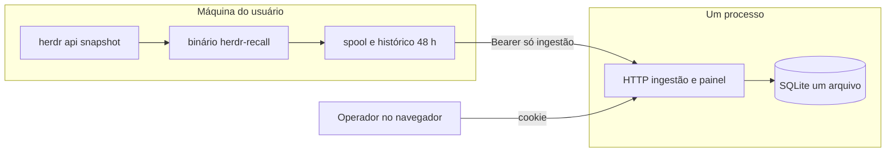

# herdr-recall — design do produto e do sistema visual

| Campo | Valor |
| --- | --- |
| Autor | [a preencher] |
| Data | 2026-11-12 |
| Status | Draft |
| Nome | **herdr-recall** (provisório) |
| Relação | Produto irmão do `ai-usage-tracker`. Não é uma página dele. Este documento é o registro do desenho. |

## Overview

O `ai-usage-tracker` mede uso de IA e recusa, no contrato, `cwd`, `path`, `prompt` e `transcript`. Isso impede que ele guarde o que uma pessoa precisa depois de uma queda de energia: qual diretório estava aberto, em qual aba e pane, qual é o id de sessão do harness e qual comando cola essa sessão de volta. O herdr-recall existe só para isso. Um agente em cada máquina lê só `herdr api snapshot`, guarda a fila na máquina e empurra a mesa atual para um servidor central. No v1 o id de sessão é o que o Herdr já reportou (`agent_session.kind == "id"`). Ler o registro local do Claude, do Grok ou do OpenCode, ou casar por pid, fica fora deste corte. O painel mostra a mesa e copia o argv. Não reabre pane, não executa comando e não envia o que a pessoa não pediu.

O painel é HTML de `html/template`, um arquivo de tokens CSS, um arquivo de componentes e poucas linhas de JS para copiar e, se o JS existir, mostrar o horário no fuso do navegador. A superfície clara é o padrão. A referência de conduta visual é a contenção operacional da Mercury (hierarquia quieta, um acento, papéis semânticos). A referência de dados é a tabela e o gráfico honesto do Geist, da Vercel. Nenhuma das duas identidades é copiada. A tela principal é uma tabela de restaurar, não um produto de analytics.

## Background & Motivation

Hoje o tracker e o Herdr cobrem metades que não se encontram.

O tracker (`README.md`, ADR 0003) enrola um dispositivo com código de uso único, guarda só o SHA-256 do token, aceita o mesmo `sample_id` com o mesmo conteúdo e responde 409 quando o id se repete com outro conteúdo. O token de dispositivo só ingere. A revogação devolve 401. A fila local (ADR 0016) é gravada antes do HTTP e só sai depois de 2xx. O serviço (ADR 0032) é unidade de usuário no systemd e LaunchAgent no macOS, sem root; Windows fica de fora. O contrato em `internal/contract/contract.go` bloqueia estas chaves:

```go
"prompt", "prompts", "message", "messages", "content",
"transcript", "transcript_path", "cwd", "path", "file_path",
"filepath", "token", "access_token", "refresh_token", "id_token",
"cookie", "cookies", "authorization", "credential", "credentials",
"api_key", "apikey", "secret", "password", "account_uuid",
"accountuuid", "oauth", "oauthaccount", "auth_json"
```

`cwd` está nessa lista de propósito. Um painel de restauração dentro do tracker ou obrigaria o tracker a aceitar caminho e sessão, ou obrigaria o recall a mentir o payload. Os dois ficam separados. O primo operacional é o painel do tracker: PWA em `web/` (Vite 8, TypeScript, Valibot, sem React; telas `/`, `/historico`, `/dispositivos`, `/alertas`, `/acesso`). Os tokens visuais dele estão em `web/src/styles.css` (tela `#f7f9fb`, acento `#0a8a6a`, raio `18px`). **Não são a fonte visual deste produto.** Não há UI de herdr-recall para auditar: o produto não tem repositório. A auditoria é dessa ausência, mais o painel do tracker como primo de operação (enrolamento, fila, serviço, estados vazio/atrasado), não como pele.

O Herdr, nesta máquina, em 2026-11-12, expõe `herdr api snapshot` e `herdr api schema` (protocolo 22, `schema_version` 1). O método `session.snapshot` devolve workspaces, tabs, panes, layouts e agents. `PaneInfo` traz `cwd`, rótulos, ids e `agent_session` (`source`, `agent`, `kind` `id|path`, `value`). Também traz `scroll`, `tokens`, `terminal_title` e afins. Uma chamada ao vivo devolveu um envelope `result.snapshot` de cerca de 90 KB; o conteúdo não foi registrado aqui e não é o payload do servidor. O snapshot não traz pid do pane. O socket tem `pane.process_info`, `pane.read`, `agent.prompt` e leitura de scrollback, mas isso não é subcomando de `herdr api`. O agente v1 não abre esse socket além do que `herdr api snapshot` já faz.

## Goals & Non-Goals

### Goals

- Guardar, por pane, o bastante para a pessoa colar o comando certo depois de perder a mesa: host, boot, hora, sessão que o Herdr reportou, workspace, aba, pane, cwd, harness, id de sessão, argv, base do casamento, confiança e ambiguidade.
- Aceitar argv só de `claude --resume`, `grok --resume` e `opencode --session`.
- Agente por máquina, servidor central, máquinas empurram. Spool local antes do HTTP, apagado só em 2xx. Mesmo `snapshot_id` e mesmo hash: sucesso idempotente, sem mover `received_at`. Hash diferente no mesmo id: 409. O hash inclui `captured_at`. Não é a comparação do ADR 0003, que ignora uma variação de `collected_at`.
- Serviço de usuário, sem root, no formato do ADR 0032. Windows sem suporte.
- Captura local a cada 60 s, com fsync do arquivo e do diretório, antes de qualquer HTTP. Envio da mesa quando o conjunto de panes muda, mais retentativa da fila em ordem FIFO. Itens de um boot anterior saem na rede antes dos itens do boot novo, e essa espera não bloqueia a gravação local.
- O servidor guarda a última captura por `(dispositivo, boot_id)`. Depois de uma queda, o painel abre no boot anterior, que ainda tem os ids. O boot novo mostra as shells restauradas quando a captura dele chega.
- O painel copia o argv. O servidor nunca reabre pane. A pessoa pode montar a mesa numa sessão nomeada vazia com `herdr-recall restore --session NOME`.
- Histórico minuto a minuto fica na máquina por 48 h (dentro da faixa de 1–2 dias já aceita). O servidor não guarda cada minuto.
- CLI local imprime a última tabela quando o servidor está fora.
- Um operador por instalação. Setup uma vez. Cookie para ver o painel. Código de enrolamento para o agente. O token de dispositivo só ingere.
- Sistema visual retocável num único arquivo de tokens. Superfície clara. Tabela densa e quieta. Um acento para o estado atual.

### Non-Goals

- Página, rota ou tabela dentro do `ai-usage-tracker`. Sem dependência de módulo entre os dois.
- React, Vite, TypeScript, PWA, biblioteca de gráfico, biblioteca de CSS, webfont.
- Login por GitHub, Gitea, Google ou Apple. Cofre. Web Push. Replicação SQLite. Vários operadores.
- **E-mail no v1.** Não há trabalho de e-mail no escopo aceito: o setup é local, o código de enrolamento aparece no painel, não há alerta nem convite. O tracker envia o e-mail da instalação por Resend, MillionSend, Cloudflare Email ou Amazon SES (`README.md`). O Sabiá é um caminho a mais nesta instalação do tracker, não o único provedor e não uma dependência do produto público. Se um dia este produto ganhar e-mail, esse conjunto de quatro provedores é a referência; não um caminho só pelo Sabiá. Isso não entra no v1 e não fica como pergunta aberta.
- O painel e o servidor executarem o argv ou reabrirem pane. Notificação, som, badge e “lembrar depois”.
- Windows. Root. Linger ligado pelo `install`.
- Gráfico de uso, série de vaidade, histórico de cada minuto no servidor, apagar remoto das capturas já aceitas (wipe). Revogar para o agente; a última mesa continua no servidor até alguém apagar o arquivo do banco.
- Tema escuro no v1. O arquivo de tokens deixa o gancho; não se entrega o bloco.
- Abrir o socket do Herdr para `pane.read`, `pane.scroll`, `agent.read`, `agent.prompt`, `pane.process_info` ou qualquer método que não seja o snapshot já impresso por `herdr api snapshot`. `pane.process_info` devolve pid, mas também `argv` e `cmdline`; não é atalho de casamento no v1.
- Casar sessão por pid ou por cwd, e ler o registro em disco do Claude, do Grok ou do OpenCode. O v1 não tem esses fixtures. Um PR posterior só começa quando eles existirem, inclusive um procedimento de macOS: esta plataforma não tem `/proc`.

## Proposed Design

### Arquitetura

Dois pacotes, no mesmo corte do tracker (`cmd/tracker` e `cmd/agent`): `cmd/recall` sobe o servidor e o painel; `cmd/agent` captura, envia e instala o serviço. O diretório `cmd/agent` não é o nome instalado. O binário do agente é `herdr-recall`. O binário do servidor é `herdr-recall-server`. Nenhum dos dois se instala como `agent`: a v0.1.0 do tracker cobriu o elo do Grok em `~/.local/bin/agent` (ADR 0025). Go **1.27.4**, o patch estável de 10 de novembro de 2026. O tracker ainda declara 1.27.3. Não é um 1.27 solto. O `go.mod` do tracker diz `module ai-usage-tracker`, não o caminho do GitHub. Este produto faz o mesmo tipo de escolha: `module herdr-recall`. O agente usa a biblioteca padrão e um processo externo, `herdr api snapshot`. Não lê `/proc` nem `ps` no v1, e não tem banco. O servidor usa `modernc.org/sqlite` v1.61.0, o mesmo módulo do tracker, puro Go, sem CGO. Os arquivos do painel entram com `go:embed`. Um processo, um arquivo de banco.



Frota pessoal: até 10 máquinas. Captura local a cada 60 s. Payload nosso, depois de cortar scroll, tokens, retângulos e títulos, guardando só a árvore de divisão: teto de 128 panes e 256 KiB. Uma mesa típica de 30 panes fica em torno de 15 KB. Pior caso, se as 10 máquinas mudarem a mesa todo minuto: cerca de 216 MB/dia na rede, e o servidor substitui a linha do boot só quando `captured_at` é maior, em vez de acumular cada minuto. Em uso quieto o envio da mesa é raro; o que segue a cada minuto é a presença, cerca de 200 B. O banco do servidor, com 14 boots por máquina, fica na ordem de alguns MB (10 × 14 × 15 KB ≈ 2 MB, mais 15 minutos de presença ≈ 30 KB). O histórico local de 48 h, se cada minuto for gravado, fica perto de 43 MB; o teto é 64 MB, e o dia mais antigo sai.

Meta de latência, neste tamanho: leitura da mesa de uma máquina abaixo de 50 ms no SQLite local; validar e gravar uma ingestão abaixo de 30 ms. Não há fila de servidor nem pool para dimensionar.

### Agente

Loop de 60 s, alinhado ao relógio monotônico, não a “mais ou menos um minuto”. O intervalo não é um minuto de parede. Cada volta grava no disco antes de abrir a rede. O servidor desta instalação pode ser a mesma máquina que acabou de ligar; o HTTP dessa hora falha, e a CLI offline precisa do arquivo novo mesmo assim.

1. Lê `boot_id`. No Linux, o texto de `/proc/sys/kernel/random/boot_id` (UUID; não ordena no tempo). No macOS, SHA-256 de `kern.boottime` em hexadecimal (também não ordena). O boot é o boot da máquina, não o restart do processo. Restart do agente no mesmo boot continua o mesmo `boot_id`. Quem ordena boots é o relógio do servidor, na tabela `boots`, não este id.
2. Roda `herdr api snapshot` com timeout de 5 s e `argv` fixo. Sem shell. Se o processo falha, a volta **não** publica mesa vazia e **não** reescreve `latest.json`. A presença desta volta leva `herdr_ok: false`. O resto da volta é o mesmo: passos 4 a 6. Não há HTTP antes do passo 6.
3. Se o snapshot vem, monta o payload allowlist. De cada aba guarda a árvore de divisão: direção (`right` ou `down`), proporção e o id do pane em cada folha. Descarta o retângulo, `scroll`, `tokens`, `terminal_title`, `terminal_title_stripped`, `restore_error`, `state_labels`, worktree, `foreground_cwd` e qualquer outro campo. O `cwd` do payload é o `cwd` do `PaneInfo`, ou vazio quando o Herdr manda nulo. Não se copia `foreground_cwd` para o lugar do `cwd`: são campos diferentes, e o v1 não casa por nenhum dos dois.
4. Monta a cauda desta volta na memória, ainda sem rede e sem substituir o spool no disco. A presença entra primeiro, com `observed_at` congelado. Se a mesa mudou, inclusive para uma lista vazia que o Herdr devolveu de verdade, o snapshot entra atrás dessa presença. O `snapshot_id` nasce ali, 32 hex de `crypto/rand`, e `captured_at` fica congelado no item. Nenhum dos dois é gerado de novo na retentativa. A cabeça do spool, com os itens já gravados, não muda de ordem. Presença na frente do snapshot desta volta faz o boot novo existir no servidor antes de a mesa nova cobrir a tela. Até esse snapshot ser aceito, o painel desenha a mesa de um boot anterior quando essa linha de `snapshots` existe, com a frase de boot anterior. Sem nenhuma linha de `snapshots`, a frase é “Nenhum pane nesta captura.” `herdr_ok` falso, com presença nova pelo `received_at`, acrescenta “Herdr sem resposta. A última captura continua aqui.”
5. Durabilidade, ainda sem rede. Grava o spool inteiro, cabeça antiga mais a cauda do passo 4. Só quando o passo 3 produziu snapshot, grava também `latest.json` e a linha do histórico. Receita, em cada um desses arquivos: temporário no mesmo diretório, `Sync` do arquivo, rename, `Sync` do diretório pai. Falha de `Sync` do arquivo ou do rename aborta a volta; o arquivo anterior fica; não há HTTP. No Linux, falha de `Sync` do diretório também corta o HTTP desta volta. O rename já pode ter ficado; o arquivo novo permanece e a próxima volta lê o spool do disco, sem cunhar outro `snapshot_id` para um item que já está lá. O produto é queda de energia, e o rename sem o diretório pode sumir no segundo corte. No macOS o mesmo `Sync` de diretório é chamado. Se o kernel recusar, a volta grava uma linha em `~/.local/state/herdr-recall/dirsync-warn`, modo 0600: a hora UTC local e a frase de que o `Sync` do diretório foi recusado. O arquivo fica. A volta segue para o passo 6, porque o arquivo em si já foi sincronizado. Não se declara o macOS tão seguro quanto o Linux nesse passo. O Linux não escreve esse arquivo.
6. Só então a rede. O spool é uma lista FIFO: o índice 0 é o mais antigo. Nesta mesma volta o agente continua a enviar a cabeça enquanto a resposta for 200 ou 409. Erro de rede ou 5xx para a volta; o item continua na cabeça e não há outro POST até a volta seguinte. 200 apaga o item, sem reescrever o corpo, e o envio segue na cabeça que sobrou, ainda nesta volta. Isso inclui o 200 que não cobre a mesa. 401 para o processo com saída 3 e não há outro POST nessa volta. 409 tira o item para `spool.conflict`, sem o corpo no log, e o envio segue na cabeça que sobrou, ainda nesta volta. Itens do boot anterior, se ainda estão na frente, saem na rede antes dos itens do boot novo, na mesma volta, enquanto a resposta for 200 ou 409. Isso não volta ao passo 5.

Conjunto de panes que dispara envio: ids de workspace, aba e pane, rótulos, `cwd` do pane, harness, id de sessão, argv, base, confiança e a árvore de divisão. `captured_at` não entra nessa comparação. Entra no hash canônico que o servidor guarda, e por isso a retentativa reenvia os bytes já gravados no spool, sem remarcar a hora. Mesa quieta não reenvia o corpo; reenvia presença.

Casamento no v1, um passo só. `agent_session` do Herdr com `kind == "id"` e `agent` normalizado para `claude`, `grok` ou `opencode`: `session_id` é esse valor, `match_basis` é `herdr_agent_session`, `confidence` é `high`, e o argv é uma das três formas abaixo. `kind == "path"` não vira sessão e o valor não é armazenado. Sem `agent_session` de id, ou com agente fora dos três nomes: `session_id` e `resume_argv` ausentes, `match_basis` `none`, `confidence` `low`. A linha continua, com workspace, aba, pane e o `cwd` do pane, para a pessoa ver o diretório. O texto é “Sem sessão para restaurar.” Não há segunda tentativa por registro local nem por pid.

Dois panes do mesmo snapshot com o mesmo `session_id` não vazio: os dois levam `ambiguous_with` com o outro `pane_id` e `confidence` `low`. O argv permanece. Isso se vê no próprio snapshot; não precisa de fixture externo. Não se marca ambiguidade só porque dois panes compartilham `cwd`. Sem id, não há comando errado para copiar.

Fora do v1, e sem PR neste corte: casar por pid ou por cwd. Não há fixture do registro do Claude, do Grok nem do OpenCode, e este documento não inventa o path. `PaneInfo` não traz pid. O Linux teria `/proc/<pid>` (`cwd` e `comm`); o macOS não tem `/proc`, então esse PR também precisa de um procedimento de macOS, que não está escrito aqui. `pane.process_info` até devolve pid, e também `argv` e `cmdline`. Continua proibido até um desenho dizer como esses dois são descartados e não sobem.

Argv é montado pelo agente e recusado de novo pelo servidor. Só estas três formas, sem flags extras, sem shell string:

- `["claude", "--resume", SESSION]`
- `["grok", "--resume", SESSION]`
- `["opencode", "--session", SESSION]`

`SESSION` casa `^[A-Za-z0-9._:-]{1,128}$`. Sem espaço, aspas ou metacaractere.

Arquivos, modo 0600, diretórios 0700:

- `~/.config/herdr-recall/agent.json` — URL do servidor e caminho do token. Não guarda o token.
- Arquivo do token, modo 0600, escrito uma vez no enrolamento.
- `~/.local/state/herdr-recall/spool.json` — lista FIFO do que ainda não teve 2xx. Cada item guarda os bytes canônicos e o `snapshot_id` ou o `observed_at` já congelados.
- `~/.local/state/herdr-recall/dirsync-warn` — uma linha quando o macOS recusa `Sync` de diretório. Ausente no Linux e quando o sync passou. O `doctor` lê este arquivo.
- `~/.local/state/herdr-recall/latest.json` — última mesa boa, para o CLI offline.
- `~/.local/state/herdr-recall/history/YYYYMMDD.jsonl` — 48 h, teto 64 MB.

`herdr-recall setup` pergunta, no terminal, a URL, o código e o nome da máquina. Grava `agent.json` e o arquivo de token. `herdr-recall enroll --api URL --code CODIGO --name NOME` faz o mesmo sem pergunta, no formato de `internal/agent/agent.go` (`Enroll` faz `POST /v1/devices` com `code` e `name`). Se a URL mudou e já existe token, os dois comandos exigem um código novo e substituem o token. A fila local não é apagada. Se a unidade já estiver instalada, o fim do comando avisa que ela segue com a configuração antiga até `herdr-recall service install`. A mesma regra está no ADR 0032.

`herdr-recall latest` imprime a tabela local sem falar com o servidor. Colunas, nesta ordem: workspace, aba, pane, diretório, harness, sessão, confiança, comando. Confiança sai como “alta” ou “baixa”, nunca `high`/`low`. Sessão vazia e comando vazio saem como “—”. O comando é a mesma linha com aspas simples que o botão Restaurar copia. Essa linha vai para a stdout porque a pessoa pediu a tabela. Log do processo, journal e arquivo de log do launchd não recebem argv, sessão nem cwd.

`herdr-recall restore --session NOME` lê `latest.json` e monta essa mesa numa sessão nomeada que ainda não tem workspace. Recusa o nome `default`. Se a sessão já tem workspace, para e diz que nada foi executado. `--plan` só lê o snapshot e escreve o plano; a última linha é “Nada foi executado.” Sem `--plan`, cria o workspace, a aba e os `pane split` com a direção e a proporção gravadas, e chama `agent start` só quando a confiança é alta, não há ambiguidade e o argv está na allowlist. O zoom, quando a captura marcou a aba, vai para a primeira folha da divisão. O log desse comando também não leva argv, sessão nem cwd. O painel e o servidor não chamam este comando.

Serviço, mesma forma do ADR 0032 e de `internal/service/service.go`:

- `herdr-recall service install | uninstall | doctor`. `install` exige config e token, recusa binário temporário de `go run`, grava o caminho absoluto de `herdr-recall`. `--dry-run` só mostra. Reinstalar reescreve e reinicia. Não cria um nome `agent` no `PATH`.
- O `PATH` da unidade é montado na hora do install, como `ServicePATH`: diretório do binário, diretório do `herdr` achado no `PATH` do shell que instala, `~/.local/bin`, `/opt/homebrew/bin` no macOS, `/usr/local/bin`, `/usr/bin`, `/bin`. Sem isso o serviço sobe com `PATH` mínimo e não acha o `herdr`.
- Linux: `~/.config/systemd/user/herdr-recall.service`. As linhas de restart são as do tracker, não só `Restart=on-failure` (isso sozinho reinicia na saída 3):

```
ExecStart=<herdr-recall> run
Environment=PATH=<path montado>
Restart=on-failure
RestartSec=60
RestartPreventExitStatus=3
```

- macOS: `~/Library/LaunchAgents/dev.herdr-recall.agent.plist`, com o mesmo `PATH` em `EnvironmentVariables`. O rótulo do arquivo tem “agent” porque é o vocabulário do launchd, igual a `dev.ai-usage.agent.plist`. Não é um executável chamado `agent`. O launchd pode reiniciar depois da revogação; o `doctor` mostra o bloqueio. `RestartPreventExitStatus` não existe no launchd. Mesma consequência do ADR 0032.
- `uninstall` tira só a unidade. Config, token, spool e histórico ficam.
- `doctor` só lê: plataforma, config, token, binário, unidade, `PATH` gravado, se `herdr` existe nesse `PATH`, linger (avisa, não liga), `/healthz`, `GET /v1/device`, fila, itens em quarentena, e `dirsync-warn` se o arquivo existir. `herdr` ausente desse `PATH` é `fail`. `dirsync-warn` presente é `warn`, não `fail`: não entra na conta que faz a saída 1. Sai 1 se houver `fail`. Sem `fail`, a saída é 0 mesmo com esse aviso.
- Windows: mensagem de sem suporte e saída 1.

Revogação: HTTP 401 com `{"error":"DEVICE_REVOKED"}`. O agente para o loop, conserva o spool, sai 3. Não pede outro token sozinho.

409: o item sai do spool ativo para `spool.conflict`, sem retentativa desse item e sem o corpo no log. A mesma volta segue na cabeça que sobrou.

```mermaid
sequenceDiagram
  participant A as Agente
  participant D as Disco local
  participant S as Servidor
  A->>A: herdr api snapshot
  A->>D: fsync do arquivo e do diretório
  Note over A,S: a rede só começa depois do disco
  loop 200 ou 409
    A->>S: POST da cabeça da FIFO
    S-->>A: 200 apaga e segue; 409 quarentena e segue
  end
  Note over A,S: erro de rede ou 5xx para a volta; 401 sai 3
```

Queda de energia:

```mermaid
sequenceDiagram
  participant A as Agente no boot novo
  participant D as Disco local
  participant S as Servidor
  participant P as Painel
  Note over S: boots.first_received_at do boot anterior é menor
  A->>D: grava latest.json do boot novo antes do HTTP
  P->>S: abre a máquina
  S-->>P: mesa antiga com boot anterior, se essa linha existe; senão, nenhum pane nesta captura
  A->>S: mesma volta, FIFO, enquanto 200 ou 409
  A->>S: presença do boot novo cria a linha boots
  A->>S: snapshot do boot novo, quando a mesa existe
  P->>S: o max de first_received_at passa a ter mesa
```

### Servidor e API

Bind padrão `127.0.0.1:8788` (o tracker usa 8787). HTTP sem TLS só em loopback. Qualquer outro bind sem certificado no listener recusa subir. Não há confiança em `X-Forwarded-Proto` no v1: quem termina TLS noutro processo faz o proxy para o loopback. Cookie `Secure` quando o listener é TLS.

Operador: uma linha, criada uma vez. Senha com no mínimo 12 caracteres, sem regra de composição, hash bcrypt custo 12 (`golang.org/x/crypto/bcrypt`, já indireto no tracker). Cookie `recall_session`: 32 bytes aleatórios, no servidor só o SHA-256, `HttpOnly`, `SameSite=Strict`, `Path=/`, vida de 12 h sem renovar. Formulários que mudam estado levam token CSRF da sessão. Ingestão não usa cookie; usa `Authorization: Bearer`.

Código de enrolamento: 10 caracteres do alfabeto Crockford sem ambíguos, um uso, 10 minutos, no servidor só o SHA-256. No máximo 5 códigos criados na última hora. A contagem usa `created_at`. Linha gasta ou expirada não é apagada no v1: sem isso, um código já usado pareceria inválido, e o limite por hora perderia as linhas. O volume cabe (cinco por hora).

Quem escolhe o nome da máquina é a pessoa, no `herdr-recall setup` ou no `enroll`. O painel não manda o nome. Validação igual a `validDeviceName` em `internal/httpapi/server.go`: trim, 1 a 64 caracteres, letra, número, espaço, hífen ou sublinhado. Fora isso, 422 no campo `name`.

A troca é `POST /v1/devices`, sem cookie e sem bearer. Corpo JSON `{"code":"...","name":"..."}`. Resposta 201: `{"device_id","token","name"}`. O `token` aparece nessa resposta e não volta. O servidor guarda só o SHA-256. Códigos de erro, os mesmos três do `enroll` do tracker, todos 401:

- `ENROLLMENT_INVALID` — hash desconhecido
- `ENROLLMENT_USED` — `used_at` já preenchido
- `ENROLLMENT_EXPIRED` — `expires_at` no passado

Código malformado (tamanho fora de 8 a 120) ou nome inválido: 422, sem consumir o código. O token de dispositivo só alcança `POST /v1/snapshots`, `POST /v1/presence` e `GET /v1/device`.

Setup: a variável é `RECALL_SETUP_TOKEN` e o cabeçalho é `X-Setup-Token`. Se a variável está definida, `GET` e `POST /acesso/setup` exigem o cabeçalho em qualquer bind, inclusive loopback, com comparação em tempo constante (`fixedEqual` no tracker). Se a variável não está definida, o setup só existe em loopback; fora dele a resposta é 403. Segunda criação, com operador já gravado: 404. A frase do ADR 0003 vale inteira, não só a metade “fora de loopback”.

Rotas:

| Método e caminho | Quem | Efeito |
| --- | --- | --- |
| `GET /healthz` | ninguém | `200` e `ok`. Sem banco de negócio na resposta. |
| `GET` e `POST /acesso/setup` | ninguém, sob a regra de `RECALL_SETUP_TOKEN` acima | Cria o operador. Segunda vez: 404. |
| `GET` e `POST /acesso/entrar` | ninguém | Abre a sessão. |
| `POST /acesso/sair` | operador | Apaga a sessão. |
| `GET /` | operador | Lista de máquinas. |
| `POST /maquinas/codigo` | operador | Mostra o código uma vez. 429 se a hora já tem 5. |
| `GET /maquinas/{id}` | operador | Mesa e boots. |
| `POST /maquinas/{id}/revogar` | operador | `revoked_at`. Não apaga capturas. |
| `POST /v1/devices` | quem tem o código | 201 com o token, ou 401/422 acima. |
| `POST /v1/snapshots` | dispositivo | Aplica a regra de ingestão abaixo. |
| `POST /v1/presence` | dispositivo | Presença, sem mesa. |
| `GET /v1/device` | dispositivo | `id`, `name`, `created_at`. Não grava. Para o `doctor`. |

Erros estáveis: `401 DEVICE_REVOKED`, `401 ENROLLMENT_INVALID`, `401 ENROLLMENT_USED`, `401 ENROLLMENT_EXPIRED`, `409 SNAPSHOT_CONFLICT`, `422` com campos. Corpo desconhecido ou chave proibida: 422, e o servidor persiste o JSON canônico, não o corpo cru. Mesma regra do ADR 0003, com a lista da seção de segurança. `cwd` é permitido aqui e proibido lá. `foreground_cwd` não é campo deste contrato.

Marshal canônico, uma função em `internal/contract`, usada pelo agente e pelo servidor. O struct de fio já traz `captured_at` e `observed_at` como `string`, no layout `2006-01-02T15:04:05.000000000Z` (nove dígitos). Não são `time.Time`. O `encoding/json` de `time.Time` usaria `RFC3339Nano` e cortaria zero à direita; esse tipo não entra no marshal. Um `map` não escolhe a ordem das chaves. JSON compacto, `SetEscapeHTML(false)`, chaves na ordem dos campos do struct de fio. `cwd`, `match_basis` e `confidence` sempre saem; `cwd` vazio é `""`, não omissão. `herdr_session`, `harness` e `session_id` somem quando vazios. Mesa sem panes é `"panes":[]`, sempre presente: nem `null`, nem omissão. Slice nil e slice de comprimento zero viram esse `[]`. A regra de nil em vez de `[]` vale só para `resume_argv` e `ambiguous_with`. Os dois somem quando vazios e nunca saem como `null` nem como `[]`. Panes ordenados por `pane_id`. O corpo do `POST` é esse JSON, com `snapshot_id`. O hash é SHA-256 de um segundo objeto, com as mesmas regras, só com `boot_id`, `captured_at`, `host` e `panes`. Mesa vazia entra nesse objeto como `"panes":[]`. O `snapshot_id` não entra no hash. `captured_at` entra. Isso não é a comparação do ADR 0003: lá uma variação de `collected_at` é o mesmo conteúdo. Aqui, mudar a hora muda o hash. Se o id é o mesmo, a resposta é 409. O agente não remarca a hora de um item que já está no spool. Os bytes do item são os do `POST`, não os do objeto hasheado: a retentativa reenvia o que foi sincronizado.

Ingestão de snapshot, nesta ordem:

1. Corpo inválido: 422. Nada é escrito.
2. Já existe recibo desse `snapshot_id` com o mesmo hash: 200. Não mexe em `snapshots`, nem em `received_at`, nem em `boots.first_received_at`.
3. Já existe recibo com hash diferente: 409 `SNAPSHOT_CONFLICT`. Não escreve a mesa.
4. Não há linha de snapshot para aquele `(device_id, boot_id)`: insere. Se não há linha em `boots`, cria com `first_received_at` igual ao relógio do servidor, uma vez. Grava o recibo. 200.
5. Há linha e `captured_at` do corpo é estritamente maior que o `captured_at` guardado: substitui payload, id, hash, `captured_at` e `received_at`. Não altera `first_received_at`. Grava o recibo. 200.
6. Há linha e `captured_at` do corpo é menor ou igual: 200, sem escrever a mesa e sem mover `received_at` nem `first_received_at`. O recibo é gravado, para um replay com outro hash nesse id ainda ser 409.

Id desconhecido não é, por si, mesa nova. Mesa nova no mesmo boot exige `captured_at` maior. Um retry de id velho, mesmo que o recibo já tenha saído dos 50, não cobre a mesa que está na tela. Relógio da máquina andando para trás dentro do mesmo boot também não cobre a mesa: a comparação da mesa continua a ser `captured_at`. A presença recém-aceita continua a dizer que o agente está vivo, porque “sem sinal”, `last_seen_at` e a poda usam o `received_at` gravado pelo servidor na inserção, não o `observed_at` do agente. Um POST que acabou de devolver 200 não é apagado por o relógio da máquina estar atrasado. A ordem entre boots não usa o relógio da máquina.

Presença: corpo `boot_id`, `observed_at`, `pane_count`, `herdr_ok`. `observed_at` fica o carimbo do agente, string de nove dígitos. Sem cwd, sem sessão, sem argv. `INSERT` com `ON CONFLICT (device_id, observed_at) DO NOTHING` e 200 nos dois casos. Conflito não é 409 e não é erro de constraint para o agente. Não atualiza `herdr_ok` de uma linha já gravada. A primeira presença aceita de um boot cria `boots.first_received_at` se a linha não existe, e não a move se existe. `presence.received_at` é o relógio do servidor no momento em que o `INSERT` cria a linha. `devices.last_seen_at` avança para esse `received_at`, não para o `observed_at`, só quando o `INSERT` cria linha e o valor é maior que o guardado. Não recua. Replay não mexe nele, e snapshot também não: o frescor da máquina é presença. A poda, na mesma transação, apaga presença cujo `received_at` é anterior a 15 minutos nesse relógio do servidor. Não olha `observed_at` para apagar. Não apaga `last_seen_at`. Uma linha acabada de inserir permanece, mesmo com `observed_at` horas atrás. “Sem sinal” compara o maior `presence.received_at` da máquina, ou `last_seen_at` se a poda já levou as linhas, com o relógio do servidor: mais de 180 s é sem sinal. Enquanto houver linha, a faixa ainda baldeia pelo `observed_at` dessas linhas. Quando a poda já levou todas, não há como saber quais minutos do carimbo do agente tinham presença; a faixa não desenha 15 faltas no lugar. “Sem sinal desde …” usa `last_seen_at`, que é hora do servidor. “Sem presença nesta máquina.” só quando `last_seen_at` é nulo. O envio da mesa continua só na mudança.

Boots: no máximo 14 por dispositivo. O mais novo é `max(first_received_at)`. Não se ordena `boot_id`, nem `captured_at`, nem `snapshots.received_at`. Empate de `first_received_at` não promove um `boot_id`. Os dois ficam. Acima de 14, sai o menor `first_received_at`. Se ainda empatar, sai o menor `boot_id` em ordem de byte, só para a escolha ser estável. Essa ordem de byte não é o que o painel chama de boot atual. Apagar um boot apaga a mesa dele. Recibos ficam até sair dos 50 mais recentes do dispositivo, pelo `received_at` do recibo.

`snapshot_id` casa `^[A-Za-z0-9_-]{16,80}$` e é gerado uma vez por item de spool. `cwd`, quando não vazio, é caminho absoluto, no máximo 1024 bytes, sem quebra de linha. Vazio é válido. Rótulos até 80 runes. Host até 253 bytes, sem controle. Nome da máquina: a regra de `validDeviceName` acima.

### O que cada estado significa

O boot mostrado por omissão é o de maior `first_received_at`. Se esse boot ainda não tem linha em `snapshots` e existe uma linha mais antiga, a mesa desenhada é essa linha e o texto é boot anterior. Se o dispositivo não tem nenhuma linha em `snapshots`, não há mesa antiga para desenhar e o texto não é boot anterior. A faixa de presença olha a máquina inteira. O bit `herdr_ok` é o da presença com maior `received_at` no boot mais novo.

| Estado | Regra | Texto |
| --- | --- | --- |
| Vista | A mesa desenhada é o boot mais novo, o `received_at` da presença mais nova desse boot está a ≤ 180 s do relógio do servidor, `herdr_ok` verdadeiro, e `captured_at` da mesa há ≤ 180 s | “Vista há …” |
| Mesa estável | A mesa desenhada é o boot mais novo, o `received_at` da presença mais nova desse boot está a ≤ 180 s do relógio do servidor, `herdr_ok` verdadeiro, e `captured_at` há mais de 180 s | “Mesa estável desde …”. Não é atraso e não é Herdr parado. |
| Herdr sem resposta | O `received_at` da presença mais nova do boot mais novo está a ≤ 180 s do relógio do servidor, e o `herdr_ok` dessa presença é falso. Vale na mesa desse boot e também quando não há nenhuma linha em `snapshots`. Não vale se a frase já é sem sinal, nem quando a mesa desenhada é uma linha antiga | “Herdr sem resposta. A última captura continua aqui.” Se não há linha em `snapshots`, a página também diz “Nenhum pane nesta captura.” A mesa antiga, quando é ela que está desenhada, fica. Não se chama isso de estável. |
| Boot anterior | A mesa desenhada é uma linha de `snapshots` cujo boot não é o de maior `first_received_at` | “Boot anterior. A mesa nova ainda não chegou.” quando o boot mais novo não tem linha. Senão, “Boot anterior.” Não se usa nenhuma das duas quando não existe linha de `snapshots`. |
| Sem sinal | O maior `presence.received_at` da máquina, ou `last_seen_at` se não restou linha, está a mais de 180 s do relógio do servidor | “Sem sinal desde …. A última captura continua aqui.” A hora é `received_at` ou `last_seen_at`, não `observed_at`. Ganha de “Herdr sem resposta”. |
| Revogado | `revoked_at` preenchido | “Agente revogado. A última captura permanece.” Faixa à parte. A mesa fica. Restaurar continua só copiando. |
| Ambíguo | Dois panes da mesma captura com o mesmo `session_id` não vazio | “A mesma sessão aparece em mais de um pane. Confira antes de colar.” |
| Sem sessão | Pane sem `session_id` | “Sem sessão para restaurar.” Sem botão. |
| Erro | Falha de ler o banco, login, ou página 500 | “Não foi possível mostrar as capturas.” Sem stack. |
| Vazio | Nenhuma máquina, ou nenhuma linha em `snapshots`, ou captura com zero panes | “Nenhum pane nesta captura.” nos dois últimos. “Nenhuma máquina. Gere um código e instale o agente.” no primeiro. |

180 s são três intervalos de 60 s no relógio do servidor, medidos em `presence.received_at`: um perdido não marca a máquina como muda. “Herdr sem resposta” usa a presença de maior `received_at` do boot mais novo, não uma presença antiga de um boot que a pessoa só está consultando, e não usa `observed_at` para essa conta.

A frase da página segue a primeira regra que casar. Revogado é faixa a mais e pode aparecer junto de qualquer uma das outras. Não troca o frescor. “Nenhum pane nesta captura.” também pode aparecer junto de “Herdr sem resposta” quando não há linha em `snapshots`.

1. Erro de leitura, login ou 500.
2. Sem sinal, quando o maior `presence.received_at` da máquina, ou `last_seen_at` se as linhas já foram podadas, está a mais de 180 s do relógio do servidor. Ganha de “Herdr sem resposta”. Não usa `observed_at`. Sem linha em `snapshots`, a página também diz “Nenhum pane nesta captura.”
3. Boot anterior, só quando a mesa desenhada é uma linha de `snapshots` de um boot que não é o de maior `first_received_at`. Não é esta frase quando o dispositivo ainda não tem linha nenhuma. Não se troca por “Herdr sem resposta”.
4. Herdr sem resposta, quando o `received_at` da presença mais nova do boot mais novo está a ≤ 180 s do relógio do servidor e `herdr_ok` é falso. Inclui a mesa desse boot e o caso sem nenhuma linha em `snapshots`. Nesse caso vazio, as duas frases aparecem.
5. Mesa estável, ou vista, com `herdr_ok` verdadeiro e mesa do boot mais novo desenhada. Estável não é o nome do Herdr parado. O `captured_at` dessa conta continua o carimbo do agente; não é o que decide “sem sinal”.
6. Nenhuma linha em `snapshots`, ou captura com zero panes, quando as regras acima não deram outra frase de mesa: “Nenhum pane nesta captura.”

### Painel

Telas, todas servidor:

1. **Setup**, uma vez. Senha e confirmação. Sem e-mail. Sem segundo fator.
2. **Entrar.** Falha: “Senha não confere.” Sem dizer se o operador existe (só existe um, e o setup já passou).
3. **Lista de máquinas.** Nome dado no enrolamento, frescor, boot mostrado, quantos panes, link. Até 10 cartões.
4. **Detalhe.** Faixa de presença, lista de boots, tabela de restaurar.
5. **Vazio, boot anterior, sem sinal, Herdr sem resposta, revogado, ambíguo, erro**, como estados da mesma casca, não como produtos.
6. **Largura estreita**, abaixo de 40 rem.

Não há gráfico de uso. Há uma faixa, e só uma, que responde “esta máquina está fresca?”. “Qual boot estou vendo?” é um controle de links, não um gráfico: desenhar boots num eixo inventaria uma série.

A faixa são 15 retângulos SVG inline, sem biblioteca. Os 15 slots são os 15 minutos UTC que terminam no minuto de `floor(observed_at)` da linha de presença com maior `received_at` ainda guardada. O balde continua o carimbo do agente. “Sem sinal” não usa esse carimbo: usa `received_at` contra o relógio do servidor. Um slot é cheio se existe alguma linha de presença com `observed_at` naquele minuto. Slot sem linha fica vazio. Duas presenças no mesmo minuto enchem um retângulo, não dois. Uma presença atrasada cai no minuto do `observed_at`, não no minuto em que o HTTP chegou. Não se interpola buraco e não se estende a faixa até “agora” quando esse `observed_at` é antigo. A frase ao lado é a da tabela de estados, então um `received_at` novo com `observed_at` velho não vira “sem sinal”. O `<title>` inclui o minuto âncora (“Presença em 15 minutos até {hora UTC}: N de 15.”). Minuto vazio é minuto sem linha dentro dessa janela. Minuto cuja linha a poda por `received_at` já apagou não vira falta desenhada; nesse caso não há retângulos, e “Sem sinal desde …” usa `last_seen_at`. Minuto com linha usa `--color-chart-current`. Minuto sem linha usa `--color-chart-muted`. O texto ao lado repete o estado em palavras. Cor não é o único sinal. A faixa não é um relógio de parede do loop: o loop é monotônico; o balde é o `observed_at`.

Desktop, tabela semântica. Colunas: Aba, Pane, Workspace, Diretório, Harness, Sessão, Confiança, e a ação Restaurar. Confiança mostra “alta” ou “baixa”. O JSON continua `high` e `low`. `match_basis` não é coluna: no v1 a confiança e a frase “sem sessão” já dizem o que a pessoa precisa, e o enum inglês não entra na tela. Números e ids com `font-variant-numeric: tabular-nums` e a face de dados. Célula desconhecida leva “—”, não “n/a”, não string vazia (prática vista na página Table do Geist; a palavra em português é o travessão, não o “N/A” de lá). A lista de boots ordena por `first_received_at` descendente e mostra essa hora do servidor. O `boot_id` pode aparecer truncado como dado. Não é a ordem da lista.

Viewport abaixo de 40 rem: a tabela vira um cartão por pane, nesta ordem, não uma tabela com scroll horizontal que esconde o comando. Alvo de toque do Restaurar, do entrar, do setup e do código: no mínimo `--size-target` (2,75 rem, 44 px). O anel de foco tem 2 px, offset 2 px, cor `--color-focus`, só em `:focus-visible`.

Sessão e comando são dados. Na célula, um resumo truncado no meio (8 + reticências + 6) com a face de dados é só visual. O comando inteiro está sempre no DOM, dentro de `<details>` nativo: `<summary>mostrar</summary>` e um `<pre>` com a linha completa. `<details>` abre sem JS. O valor completo não fica só em `title`. A forma da linha é a mesma da stdout: aspas simples em cada argumento (`claude --resume '…'`). O alfabeto do id não tem aspas; as aspas são defesa. Sem argv, não há `<details>` nem botão; a célula diz “Sem sessão para restaurar.”

Restaurar copia essa linha inteira, não o resumo. O texto copiado não é interpolado num literal JavaScript. O template põe a linha no atributo `data-argv` do botão, e `html/template` escapa o atributo. `panel.js` lê `dataset.argv`. Proibido `template.HTML`. Proibido `fmt` dessa string para dentro de `<script>`. Sucesso, por 2 s: “Comando copiado. Nada foi executado.” Falha do clipboard: o `<pre>` já está na página; o texto passa a “Não foi possível copiar. Selecione o comando.” O botão não executa.

JS único, `panel.js`: copiar a partir de `data-argv`; trocar o texto de `time[datetime]` para o fuso do navegador. O HTML já traz UTC. Sem JS, a pessoa abre `mostrar` e seleciona o `<pre>`, e a hora continua em UTC. Sem fetch, sem framework.

O nome provisório aparece como texto, a partir de uma constante Go. Não há wordmark desenhado, ícone de marca ou favicon ilustrado no v1 além de um quadrado na cor de acento, para não fabricar identidade emprestada.

### Sistema visual

Não há tela atual para fotografar. O método abaixo define o sistema que o primeiro CSS tem de cumprir. A pele do tracker não entra.

#### 1. Conceito e princípios

Conceito: uma mesa de trabalho em papel claro, densa o bastante para 30 panes, quieta o bastante para não parecer alarme. A pessoa veio recuperar um comando, não para ser medida.

Princípios, cada um testável:

1. **Restaurar é copiar.** O painel nunca é o processo que abre a sessão. *Assim nunca* há botão que dê exec, nunca há restauração automática no load, nunca o texto de sucesso diz que a sessão voltou.
2. **Uma coisa, uma palavra.** O glossário desta seção é fechado. *Assim nunca* a UI chama a máquina de device, a captura de snapshot, ou o boot de sessão.
3. **Dado quieto, estado honesto.** Cor repete a palavra; não a substitui. *Assim nunca* um ponto colorido sozinho significa sem sinal, e nunca um gráfico preenche minuto que o servidor não recebeu.
4. **O arquivo de tokens é o único lugar da aparência.** *Assim nunca* um template ou uma regra de componente ganha hex, família de fonte ou espaçamento mágico para “só este caso”.
5. **O mínimo que permite continuar o trabalho.** *Assim nunca* o payload leva prompt, transcrição, scrollback, ambiente ou credencial, e nunca o produto fala com a pessoa sem ela ter aberto o painel.

#### 2. Tokens

Dois níveis, um arquivo, `internal/web/tokens.css`, carregado antes de `components.css`. Nível cru (`--stone-900`, `--tide-700`) e nível semântico (`--color-text`). Template e componente usam só o semântico. Mudar acento, superfície, tipo, raio ou densidade é editar este arquivo.

Os valores crus são deste produto. Não são a escala neutra da Mercury, nem o índigo `#5266eb`, nem o verde `#0a8a6a` do tracker, nem o azul `#0B7BFE` visto no HTML do Geist, nem o cinza `hsl(0 0% …)` do Geist. A escolha é uma pedra quente para a superfície clara e um azul-petróleo único para o estado atual e para a ação primária. Petróleo não é o verde do tracker nem o roxo da Mercury; cabe em “um acento, o resto mudo”, que é o padrão das duas referências, sem usar a tinta delas.

Escala crua:

| Token | Valor | Papel cru |
| --- | --- | --- |
| `--stone-0` | `#fffdf9` | Superfície mais alta |
| `--stone-25` | `#f3efe7` | Tela |
| `--stone-50` | `#e7e1d6` | Superfície muda, hover |
| `--stone-100` | `#d9d1c3` | Pressed de superfície |
| `--stone-200` | `#c4b9a6` | Fio decorativo |
| `--stone-300` | `#a89b86` | Não usar em texto nem em borda essencial |
| `--stone-400` | `#7d7263` | Borda essencial e marca muda do gráfico |
| `--stone-500` | `#5e564b` | Texto desabilitado |
| `--stone-600` | `#474138` | Texto secundário |
| `--stone-700` | `#322e28` | Não usado em texto no v1; reserva da escala |
| `--stone-800` | `#221f1b` | Reserva |
| `--stone-900` | `#141210` | Texto |
| `--tide-100` | `#e4f0f1` | Lavagem do acento |
| `--tide-700` | `#1c4e57` | Acento |
| `--tide-800` | `#163f46` | Acento hover |
| `--tide-900` | `#102f35` | Acento pressed |
| `--clay-100` | `#f8efe4` | Lavagem de cautela |
| `--clay-700` | `#7a4510` | Texto de cautela |
| `--brick-100` | `#f8eceb` | Lavagem de erro |
| `--brick-700` | `#8e2d2d` | Texto de erro |

Papéis semânticos:

| Token | Aponta para | Onde entra |
| --- | --- | --- |
| `--color-canvas` | `--stone-25` | Fundo da página |
| `--color-surface` | `--stone-0` | Cartão, linha, campo |
| `--color-surface-muted` | `--stone-50` | Cabeçalho de tabela, código gasto |
| `--color-surface-hover` | `--stone-50` | Hover de linha e botão secundário |
| `--color-surface-pressed` | `--stone-100` | Pressed secundário |
| `--color-selected` | `--tide-100` | Boot selecionado, linha mostrada |
| `--color-caution-wash` | `--clay-100` | Faixa de ambíguo e de boot anterior |
| `--color-danger-wash` | `--brick-100` | Faixa de erro |
| `--color-text` | `--stone-900` | Texto, inclusive id e comando |
| `--color-text-secondary` | `--stone-600` | Hora, confiança, legenda |
| `--color-text-disabled` | `--stone-500` | Controle desabilitado |
| `--color-text-accent` | `--tide-700` | Link e palavra “Vista” |
| `--color-text-caution` | `--clay-700` | “Boot anterior”, “Ambíguo” |
| `--color-text-danger` | `--brick-700` | Erro |
| `--color-on-accent` | `--stone-0` | Texto sobre o botão primário |
| `--color-accent` | `--tide-700` | Restaurar, código, minuto com presença |
| `--color-accent-hover` | `--tide-800` | Hover primário |
| `--color-accent-pressed` | `--tide-900` | Pressed primário |
| `--color-focus` | `--tide-700` | Anel |
| `--color-line` | `--stone-200` | Fio decorativo entre linhas |
| `--color-line-strong` | `--stone-400` | Borda de campo e de botão secundário |
| `--color-chart-current` | `--tide-700` | Minuto com presença |
| `--color-chart-muted` | `--stone-400` | Minuto sem presença |

Tipo, espaço, forma, movimento e medida também são tokens; a lista completa está no arquivo de exemplo mais abaixo. Componentes não repetem o número.

Contraste, WCAG 2.2. Canal `s = c/255`. Se `s ≤ 0,04045`, `lin = s/12,92`; senão `lin = ((s+0,055)/1,055)^2,4`. `L = 0,2126 R + 0,7152 G + 0,0722 B`. Razão `(L_claro + 0,05) / (L_escuro + 0,05)`. Texto corrido, inclusive 12 px e 13 px, precisa de 4,5:1. Texto grande e UI essencial precisam de 3:1. Os títulos usam a mesma tinta do corpo, então passam de 4,5 sem depender da exceção de texto grande.

Conta completa de um par, texto `#141210` sobre tela `#f3efe7`:

- Texto, rgb(20, 18, 16). `lin` = 0,006995, 0,006049, 0,005182. `L = 0,2126×0,006995 + 0,7152×0,006049 + 0,0722×0,005182 = 0,006187`.
- Tela, rgb(243, 239, 231). `lin` = 0,896269, 0,863157, 0,799103. `L = 0,865572`.
- Razão `(0,865572 + 0,05) / (0,006187 + 0,05) = 0,915572 / 0,056187 = 16,29`.

Luminâncias usadas na tabela: `#141210` 0,0062; `#f3efe7` 0,8656; `#fffdf9` 0,9835; `#e7e1d6` 0,7569; `#e4f0f1` 0,8517; `#f8efe4` 0,8729; `#f8eceb` 0,8595; `#474138` 0,0541; `#1c4e57` 0,0638; `#163f46` 0,0417; `#102f35` 0,0240; `#7a4510` 0,0843; `#8e2d2d` 0,0782; `#5e564b` 0,0954; `#7d7263` 0,1730; `#a89b86` 0,3349. A razão é `(L_claro+0,05)/(L_escuro+0,05)` com esses L.

| Par que entra no v1 | Conta | Razão | Exigência |
| --- | --- | --- | --- |
| Texto / tela | (0,8656+0,05)/(0,0062+0,05) | 16,29 | 4,5 |
| Texto / superfície | (0,9835+0,05)/(0,0062+0,05) | 18,39 | 4,5 |
| Texto / superfície muda | (0,7569+0,05)/(0,0062+0,05) | 14,36 | 4,5 |
| Texto / realce | (0,8517+0,05)/(0,0062+0,05) | 16,05 | 4,5 |
| Texto / lavagem de cautela | (0,8729+0,05)/(0,0062+0,05) | 16,43 | 4,5 |
| Texto / lavagem de erro | (0,8595+0,05)/(0,0062+0,05) | 16,19 | 4,5 |
| Secundário / tela | (0,8656+0,05)/(0,0541+0,05) | 8,80 | 4,5 |
| Secundário / superfície | (0,9835+0,05)/(0,0541+0,05) | 9,93 | 4,5 |
| Secundário / muda | (0,7569+0,05)/(0,0541+0,05) | 7,75 | 4,5 |
| Secundário / realce | (0,8517+0,05)/(0,0541+0,05) | 8,66 | 4,5 |
| Secundário / cautela | (0,8729+0,05)/(0,0541+0,05) | 8,87 | 4,5 |
| Secundário / erro | (0,8595+0,05)/(0,0541+0,05) | 8,74 | 4,5 |
| Acento / tela | (0,8656+0,05)/(0,0638+0,05) | 8,04 | 4,5 |
| Acento / superfície | (0,9835+0,05)/(0,0638+0,05) | 9,08 | 4,5 |
| Acento / muda | (0,7569+0,05)/(0,0638+0,05) | 7,09 | 4,5 |
| Acento / realce | (0,8517+0,05)/(0,0638+0,05) | 7,92 | 4,5 |
| Sobre acento | (0,9835+0,05)/(0,0638+0,05) | 9,08 | 4,5 |
| Sobre acento hover | (0,9835+0,05)/(0,0417+0,05) | 11,27 | 4,5 |
| Sobre acento pressed | (0,9835+0,05)/(0,0240+0,05) | 13,97 | 4,5 |
| Cautela / tela | (0,8656+0,05)/(0,0843+0,05) | 6,82 | 4,5 |
| Cautela / superfície | (0,9835+0,05)/(0,0843+0,05) | 7,69 | 4,5 |
| Cautela / lavagem | (0,8729+0,05)/(0,0843+0,05) | 6,87 | 4,5 |
| Perigo / tela | (0,8656+0,05)/(0,0782+0,05) | 7,14 | 4,5 |
| Perigo / superfície | (0,9835+0,05)/(0,0782+0,05) | 8,06 | 4,5 |
| Perigo / lavagem | (0,8595+0,05)/(0,0782+0,05) | 7,10 | 4,5 |
| Desabilitado / tela | (0,8656+0,05)/(0,0954+0,05) | 6,30 | 4,5, embora inativo seja isento |
| Desabilitado / superfície | (0,9835+0,05)/(0,0954+0,05) | 7,11 | 4,5 |
| Desabilitado / muda | (0,7569+0,05)/(0,0954+0,05) | 5,55 | 4,5 |

UI não textual, mínimo 3:1:

| Par | Conta | Razão |
| --- | --- | --- |
| Borda essencial `#7d7263` / tela | (0,8656+0,05)/(0,1730+0,05) | 4,11 |
| Borda essencial / superfície | (0,9835+0,05)/(0,1730+0,05) | 4,64 |
| Anel `#1c4e57` / tela | (0,8656+0,05)/(0,0638+0,05) | 8,04 |
| Ponto “vista” / superfície | (0,9835+0,05)/(0,0638+0,05) | 9,08 |
| Ponto de cautela / superfície | (0,9835+0,05)/(0,0843+0,05) | 7,69 |
| Traço “sem sinal” `#5e564b` / superfície | (0,9835+0,05)/(0,0954+0,05) | 7,11 |
| Barra muda do gráfico / tela | (0,8656+0,05)/(0,1730+0,05) | 4,11 |

`--color-line` (`#c4b9a6` sobre a tela) fica por volta de 1,7:1. É fio decorativo. A separação da linha da tabela também é o espaçamento e o botão. Campo de formulário usa `--color-line-strong`. `--stone-300` (2,38:1 sobre a tela) não entra em componente.

#### 3. Tipografia

Uma família de texto e uma de dados. A de dados só serve a id de sessão, argv, cwd, boot id, host e hora. Não há terceira família, nem display, nem itálico editorial.

- `--font-text`: `ui-sans-serif, system-ui, "Segoe UI", sans-serif`
- `--font-data`: `ui-monospace, "SFMono-Regular", "Cascadia Mono", Menlo, monospace`

Não se embute Arcadia, Tiempos, IBM Plex, Geist Sans nem Geist Mono. Trocar a família no futuro é trocar o token. Até lá, zero requisição de fonte.

| Token | Valor | Uso |
| --- | --- | --- |
| `--font-size-caption` | 0,75 rem | Legenda da faixa. Tinta `--color-text-secondary` (8,80:1), nunca a pedra 400. |
| `--font-size-small` | 0,875 rem | Botão, célula secundária |
| `--font-size-body` | 1 rem | Corpo e célula principal |
| `--font-size-title` | 1,375 rem | Título da página, peso forte |
| `--font-weight-body` | 400 | Texto |
| `--font-weight-strong` | 600 | Título, botão, cabeçalho de coluna |
| `--line-body` | 1,45 | Texto |
| `--line-data` | 1,35 | Ids e argv |
| `--line-title` | 1,25 | Título |

Pesos fracionários (360, 420, 480), vistos na Mercury, dependem da fonte variável deles. Não se imitam com `font-synthesis`. Números de hora, contagem de panes e posição da faixa usam `tabular-nums` na face de texto; ids usam a face de dados.

#### 4. Espaço, layout, forma, profundidade

Base 4 px, em rem: `--space-1` 0,25; `--space-2` 0,5; `--space-3` 0,75; `--space-4` 1; `--space-5` 1,5; `--space-6` 2; `--space-8` 3. Célula de tabela: `--space-2` `--space-3`. Página: `--space-4`, conteúdo no máximo `--layout-content` (72 rem).

Raio de controle 0,375 rem. Raio de cartão 0,625 rem. Não há pílula de 40 px: isso é assinatura de marketing da homepage da Mercury, não um controle de mesa. Sombra só em `--shadow-overlay`, um véu, para o raro painel do código de enrolamento. Tabela não tem sombra. Hover de linha é troca de superfície, não elevação.

#### 5. Iconografia

Um estilo: SVG inline, viewBox 16, traço 1,5, pontas arredondadas, `currentColor`, sem preenchimento, exceto o ponto de estado (círculo de `--size-dot`). Conjunto fechado: máquina, boot, copiar, cautela, sem sinal, erro, certo. Ícone decorativo leva `aria-hidden`. Estado sempre tem palavra. Sem emoji, sem segundo pacote de ícones, sem sprite externo.

#### 6. Movimento

`--duration-fast` 120 ms, `--ease-out` só em cor e outline. Sem animar layout, sem barra que cresce, sem loop. `prefers-reduced-motion: reduce` zera `--duration-fast` no arquivo de tokens. Componente que já usa o token não precisa de outro ramo. A faixa de presença não se anima: os 15 retângulos já nascem no estado certo.

#### 7. Voz

Português, tratamento impessoal, como os ADR do tracker. Glossário obrigatório:

| Conceito | Palavra | Não usar na UI |
| --- | --- | --- |
| Computador enrolado | máquina | device, host, nó |
| Boot da máquina | boot | sessão, restart |
| Mesa aceita | captura | snapshot, sample |
| Divisão do Herdr | pane | painel, split, terminal |
| Aba do Herdr | aba | tab |
| Workspace do Herdr | workspace | projeto, pasta |
| Claude, Grok ou OpenCode | harness | provider, agente (a palavra agente fica com o processo local) |
| Copiar o argv | restaurar | resume, executar, abrir |
| Sinal periódico | presença | batimento, heartbeat, ping |
| Casamento incerto | ambíguo | warning, atenção |
| `confidence` `high` | alta | high |
| `confidence` `low` | baixa | low |
| Presença velha | sem sinal | offline, morto |
| Boot que não é o mais novo | boot anterior | stale, atrasado como título de página |

“Atrasada” não é rótulo de mesa quieta. Mesa quieta com presença nova é “estável”.

Microcopy fechada:

- Nenhuma máquina: “Nenhuma máquina. Gere um código e instale o agente.”
- Máquina sem panes, captura com zero panes, ou ainda nenhuma linha em `snapshots`: “Nenhum pane nesta captura.”
- Sem sessão: “Sem sessão para restaurar.”
- Ambíguo: “A mesma sessão aparece em mais de um pane. Confira antes de colar.”
- Sem sinal: “Sem sinal desde {hora}. A última captura continua aqui.” A hora é `received_at` ou `last_seen_at`.
- Herdr parado, com presença nova pelo `received_at`: “Herdr sem resposta. A última captura continua aqui.” Sem linha em `snapshots`, esta frase vem junto de “Nenhum pane nesta captura.”
- Boot anterior, mesa antiga desenhada e o boot mais novo ainda sem linha: “Boot anterior. A mesa nova ainda não chegou.”
- Boot anterior, a mesa desenhada é uma linha antiga e o boot mais novo também tem linha: “Boot anterior.”
- Copiado: “Comando copiado. Nada foi executado.”
- Erro: “Não foi possível mostrar as capturas.”
- Login: “Senha não confere.”
- Revogado, ainda visível: “Agente revogado. A última captura permanece.”
- Nenhuma presença ainda: “Sem presença nesta máquina.”

Sem “urgente”, “agora mesmo”, “não perca”, “sucesso”, “restaurado” no sentido de sessão reaberta. Hora relativa curta só na faixa (“há 1 min”). Acima de um dia, data absoluta. Não se inventa urgência em mesa estável.

#### 8. Componentes e estados

Cada controle abaixo tem de ter os estados que lhe cabem. “—” quer dizer que o estado não existe nesse controle, não que ficou para depois.

| Controle | default | hover | focus | pressed | selected | disabled | loading | empty | error | offline | stale | ambiguous |
| --- | --- | --- | --- | --- | --- | --- | --- | --- | --- | --- | --- | --- |
| Botão Restaurar | acento | hover | anel | pressed | — | sem argv: superfície muda, sem clique | `aria-busy` enquanto a promise do clipboard não volta | — | texto de falha de cópia | o botão continua, a página é que diz sem sinal | o botão continua no boot anterior | o botão continua, a faixa amarela explica |
| Botão secundário (gerar código, sair) | linha forte | superfície hover | anel | pressed | — | tinta desabilitada | — | — | — | — | — | — |
| `details` “mostrar” | fechado, comando inteiro no DOM | — | anel no `summary` | — | aberto | sem argv: o elemento não é renderizado | — | — | — | — | — | — |
| Campo (senha no setup e no entrar) | superfície, linha forte | linha forte | anel | — | — | desabilitado | — | placeholder no tom secundário | lavagem e texto de erro, `aria-invalid` | — | — | — |
| Linha da tabela / cartão | superfície | hover | anel no controle de dentro, não na linha inteira | — | lavagem de acento se o `details` está aberto | — | — | a página troca a tabela por frase vazia, não um `<tbody>` vazio | — | texto “sem sinal” na página, linha permanece | faixa de boot anterior na página | lavagem de cautela na linha |
| Link de boot | texto | sublinhado | anel | — | `aria-current`, fundo `--color-selected` | — | — | — | — | — | o link do boot anterior usa texto de cautela | — |
| Faixa de presença | 15 marcas do minuto âncora | — | o SVG não é foco; o texto ao lado está no fluxo | — | — | — | sem linhas ainda: “Sem presença nesta máquina.” | igual ao loading | — | a frase sem sinal; a faixa não finge o minuto atual | a frase do boot anterior; a faixa segue a máquina | — |
| Página | tela | — | primeiro campo no entrar e no setup | — | — | — | navegação cheia do browser; sem spinner de framework | “Nenhum pane nesta captura.” quando não há linha de `snapshots` ou a captura tem zero panes | frase de erro, sem stack | frase sem sinal, pelo `received_at`; ganha de Herdr sem resposta | “Boot anterior.” ou “Boot anterior. A mesa nova ainda não chegou.”, só com linha antiga desenhada | frase ambígua na linha. Revogado é faixa à parte, somada ao frescor, não este estado |

Loading de página é a navegação. Não há esqueleto animado. O ponto de estado nunca aparece sem a palavra da tabela de estados. “Herdr sem resposta” não usa a lavagem de boot anterior e não usa o rótulo “estável”. Sem nenhuma linha em `snapshots`, `herdr_ok` falso mostra essa frase junto de “Nenhum pane nesta captura.” “Agente revogado” fica visível mesmo quando a faixa ainda tem presença.

#### 9. Limite ético

O painel ajuda a retomar trabalho. Não cobra, não restaura sozinho, não manda notificação que a pessoa não pediu. Não há permissão de notificação para pedir. Não há e-mail “sua máquina caiu”. Não há contagem de quanto tempo a pessoa ficou fora, nem ranking de máquinas, nem “você costuma restaurar este pane”. A faixa de 15 minutos existe para distinguir sinal de silêncio, não para avaliar a pessoa. Copiar é sempre um gesto explícito no botão Restaurar.

#### 10. Diretivas verificáveis

1. MUST o painel usar só tokens semânticos em template e em `components.css`.
2. MUST NOT haver em `components.css` ou em template cor crua (`#`, `rgb(`, `hsl(`), `font-size` em px, ou margem, padding e gap que não sejam `var(--space-*)`, `var(--size-*)` ou `var(--layout-*)`. Exceções únicas e testadas: o literal `40rem` na media query, que tem de ser igual a `--layout-narrow`; o `stroke-width: 1.5` só na classe `.icon`; o valor `0`.
3. MUST `tokens.css` ser o primeiro CSS.
4. MUST NOT componente referir `--stone-*`, `--tide-*`, `--clay-*` ou `--brick-*`.
5. MUST todo par texto/superfície da tabela de contraste continuar ≥ 4,5:1, e toda borda essencial, anel e marca do gráfico ≥ 3:1. Um teste Go lê os hex do arquivo de tokens e recalcula.
6. MUST NOT shippar `--stone-300` nem `--stone-400` como cor de texto. `--stone-400` só via `--color-line-strong` e `--color-chart-muted`.
7. MUST o botão Restaurar copiar e MUST NOT qualquer handler executar o argv ou chamar o Herdr.
8. MUST o texto de sucesso ser “Comando copiado. Nada foi executado.”
9. MUST argv fora das três formas receber 422 e não ser guardado.
10. MUST NOT o payload aceitar prompt, transcrição, scrollback, ambiente, credencial, título de terminal, `tokens` ou `scroll`.
11. MUST `cwd` ser aceito neste produto e MUST NOT ser logado.
12. MUST NOT id de sessão, argv, cwd, senha, código ou token aparecer em log, query string ou `Referer`.
13. MUST o servidor guardar só SHA-256 do token de dispositivo, do código e do cookie.
14. MUST spool ser apagado só em 2xx. 401 para o loop com saída 3. 409 vai para quarentena.
15. MUST falha do `herdr api snapshot` não substituir a última mesa por uma lista vazia.
16. MUST a faixa não desenhar minuto sem linha de presença como se houvesse presença, e MUST NOT ancorar os 15 slots em “agora” quando o `observed_at` da linha de maior `received_at` é mais velho. MUST “sem sinal”, `last_seen_at` e a poda de 15 minutos usarem `presence.received_at` no relógio do servidor, não `observed_at`.
17. MUST NOT haver biblioteca de gráfico, webfont, React, Vite ou PWA neste corte.
18. MUST NOT haver emoji como ícone.
19. MUST cada estado da tabela de componentes existir no CSS ou no template, incluindo `:focus-visible`, não só `:focus`.
20. MUST `prefers-reduced-motion: reduce` zerar a duração.
21. MUST alvos de Restaurar, entrar, setup e gerar código ter no mínimo 2,75 rem.
22. MUST a UI usar o glossário. MUST NOT usar as palavras da coluna “não usar”.
23. MUST NOT o v1 enviar e-mail, push ou notificação.
24. MUST serviço de usuário, sem root. MUST NOT haver suporte Windows além da mensagem.
25. MUST histórico minuto a minuto ficar só na máquina, 48 h, teto 64 MB. O servidor guarda uma mesa por boot, no máximo 14 boots ordenados por `boots.first_received_at`, e 15 minutos de presença.
26. MUST NOT existir um executável instalado chamado `agent`. O agente é `herdr-recall`. O servidor é `herdr-recall-server`.
27. MUST a unidade systemd levar `RestartPreventExitStatus=3` junto de `Restart=on-failure`, e MUST o `PATH` gravado no install incluir o diretório do `herdr`. `doctor` em `fail` se `herdr` não está nesse `PATH`.
28. MUST a captura nova ser sincronizada no disco antes de qualquer HTTP daquela volta. MUST NOT um spool de boot antigo impedir essa escrita.

#### 11. Checklist antes de entregar uma tela

- Tokens novos nasceram em `tokens.css` e têm papel semântico, ou não nasceram.
- `components.css` não contém hex. O teste do item 5 passou.
- Contraste dos pares novos está na tabela deste documento, com a conta.
- Os doze estados que cabem ao controle foram olhados no browser, com teclado.
- Viewport a 360 px e a 1280 px. O comando completo dá para mostrar sem scroll horizontal.
- “Mostrar” é um `<details>` com o comando inteiro no HTML, aberto sem JS. Restaurar copia o `data-argv`, não um literal dentro de script. A stdout de `herdr-recall latest` tem a mesma linha.
- Frases batem com a microcopy. Nenhuma palavra da coluna proibida. `herdr_ok` falso não sai como “Mesa estável”. Revogado tem faixa própria.
- A faixa usa o minuto âncora do `observed_at` da linha com maior `received_at`. Não preenche minuto sem linha e não desenha falta no lugar de linha já podada. “Sem sinal” lê `received_at`.
- Sem sinal, boot anterior, ambíguo e erro têm frase, não só cor.
- A faixa tem buraco onde faltou presença.
- Log de uma ingestão de prova não contém cwd nem sessão.
- `curl` sem cookie não vê a mesa. Token de dispositivo não abre `GET /`.
- Com `prefers-reduced-motion`, nada se move.
- Nenhum asset pede fonte ou script de terceiro.

#### 12. Pesquisa e o que não foi pesquisado

Consultado em 2026-11-12:

- Mercury, página aberta no Firefox. Título: “Online Business Banking For Startups, Small Businesses & Scaling Companies”. URL: `https://mercury.com/`. O herói visível é fotografia de campo com uma frase grande, um campo e dois botões, um preenchido e um fantasma. Isso é marketing. Não é o layout do painel. O CSS ligado por essa página (`/_next/static/chunks/18fjvnz4i80vw.css`, `27f42hqblt8tf.css`, `3op2jaxl_h-yw.css`, `42s24cvdk5l2a.css`) é a fonte dos números abaixo.
- Geist Colors. Título: “Colors”. URL: `https://vercel.com/geist/colors`. Texto da página mais o CSS que ela referencia.
- Geist Typography. Título: “Typography”. URL: `https://vercel.com/geist/typography`.
- Geist Table. Título: “Table”. URL: `https://vercel.com/geist/table`.
- Geist Gauge. Título: “Gauge”. URL: `https://vercel.com/geist/gauge`.
- Painel da Vercel. `https://vercel.com/dashboard` redirecionou para `https://vercel.com/login?next=%2Fdashboard`, título “Login – Vercel”. A analytics autenticada e qualquer dashboard de Vercel Labs atrás de login não foram vistos.
- Código do tracker citado nas seções anteriores, e o CLI local `herdr api schema` / `herdr api snapshot` (protocolo 22). O corpo do snapshot não foi copiado para este documento.

Padrões extraídos, não a identidade:

- Mercury separa escala crua e papel (`--color-neutral-base-*` contra `--text-default`, `--text-subdued`, `--text-emphasized`, `--surface-primary`, `--border-focus`). A superfície clara de produto está nos tokens mesmo com o herói escuro: `--background-default` é `--color-neutral-base-50` `#fbfcfd`, secundário `#f4f5f9`, superfície `#ededf3`, elevada `#fff`, texto `#272735`, texto baixo `#535461`, texto forte `#1e1e2a`, desabilitado `#70707d`. Um acento só, `#5266eb`, com hover `#4354c8` e active `#3442a6`, também usado no foco. Erro de texto `#d03275`. Espaço nomeado de 4 a 32 px e gaps semânticos (`--gap-sm` 16, `--gap-lg` 24, `--gap-xl` 32). Foco visível com outline de 2 px. Hover de cor em 300 ms ease-out. Fontes deles: Arcadia Text (360–500), Arcadia Display (320–480), IBM Plex Mono, Tiempos Headline. Uma ação preenchida por faixa.
- Geist pede cinza sólido para texto, ícone, preenchimento e borda; cinza com alfa só quando a superfície de trás tem de aparecer (sombra, overlay). Duas telas de fundo (100% e 98% de luminosidade nos tokens `--ds-background-100` e `--ds-background-200`). Três fundos de componente (default, hover, active) e três forças de borda. Texto primário e secundário tratados como par acessível. Sombra translúcida, não halo opaco. No CSS dessa página: `--geist-background: #fff`, `--geist-marketing-gray: #fafbfc`, escala gray em `hsl(0 0% …)`, alfa de `#0000000d` a `#000000e8`. O HTML da página Colors também continha uma ocorrência de `#0B7BFE`; não foi adotado. Tipografia em degraus nomeados (heading, button, label, copy), com mono e `tabular-nums` para número. A página Table pede `<table>` quando a linha tem a mesma forma, estado vazio fora da tabela, “—” para desconhecido, cabeçalho como nome, não frase. A página Gauge pede número com nome ao lado, cor de limiar acompanhada de texto, e Status Dot ou Badge para estado enumerado em vez de gráfico. Por isso a frescor da máquina é faixa de presença mais frase, não gauge de “saúde” percentual: não há um máximo verdadeiro além de “chegou ou não chegou o minuto”.

O que foi de propósito deixado de fora: pílula, fotografia, wordmark MERCURY, Arcadia, Tiempos, Geist como fonte obrigatória, índigo `#5266eb`, verde do tracker, tema escuro de marketing (`#171721`), outline glow, gráfico de série.

Não pesquisado, e não usado como fonte:

- O app autenticado em `app.mercury.com` e o fluxo “Launch demo” da homepage. Não foram abertos. A leitura operacional da Mercury veio dos tokens claros no CSS e da hierarquia de uma ação, não de um extrato bancário ao vivo.
- Dashboard e analytics da Vercel depois do login. A página de login é o registro da falha.
- Páginas Geist que só apareceram no índice (Materials, Status Dot, Font, Empty State) e não foram abertas. Status Dot é citado só pela frase da página Gauge.
- Reconstruções de terceiros da “design system” da Mercury. A busca achou textos que se contradizem (um diz que a marca é só escura, outro publica outra paleta). Foram ignorados.
- Paths em disco dos registros de sessão do Claude, do Grok e do OpenCode. Ficam para o PR do parser, com fixture. Não se inventam aqui.

Amostra do arquivo de tokens, pronta para colar. O bloco `@media` de movimento mora neste arquivo de propósito.

```css
:root {
  color-scheme: light;
  --stone-0: #fffdf9;
  --stone-25: #f3efe7;
  --stone-50: #e7e1d6;
  --stone-100: #d9d1c3;
  --stone-200: #c4b9a6;
  --stone-300: #a89b86;
  --stone-400: #7d7263;
  --stone-500: #5e564b;
  --stone-600: #474138;
  --stone-700: #322e28;
  --stone-800: #221f1b;
  --stone-900: #141210;
  --tide-100: #e4f0f1;
  --tide-700: #1c4e57;
  --tide-800: #163f46;
  --tide-900: #102f35;
  --clay-100: #f8efe4;
  --clay-700: #7a4510;
  --brick-100: #f8eceb;
  --brick-700: #8e2d2d;

  --color-canvas: var(--stone-25);
  --color-surface: var(--stone-0);
  --color-surface-muted: var(--stone-50);
  --color-surface-hover: var(--stone-50);
  --color-surface-pressed: var(--stone-100);
  --color-selected: var(--tide-100);
  --color-caution-wash: var(--clay-100);
  --color-danger-wash: var(--brick-100);
  --color-text: var(--stone-900);
  --color-text-secondary: var(--stone-600);
  --color-text-disabled: var(--stone-500);
  --color-text-accent: var(--tide-700);
  --color-text-caution: var(--clay-700);
  --color-text-danger: var(--brick-700);
  --color-on-accent: var(--stone-0);
  --color-accent: var(--tide-700);
  --color-accent-hover: var(--tide-800);
  --color-accent-pressed: var(--tide-900);
  --color-focus: var(--tide-700);
  --color-line: var(--stone-200);
  --color-line-strong: var(--stone-400);
  --color-chart-current: var(--tide-700);
  --color-chart-muted: var(--stone-400);

  --font-text: ui-sans-serif, system-ui, "Segoe UI", sans-serif;
  --font-data: ui-monospace, "SFMono-Regular", "Cascadia Mono", Menlo, monospace;
  --font-size-caption: 0.75rem;
  --font-size-small: 0.875rem;
  --font-size-body: 1rem;
  --font-size-title: 1.375rem;
  --font-weight-body: 400;
  --font-weight-strong: 600;
  --line-body: 1.45;
  --line-data: 1.35;
  --line-title: 1.25;

  --space-0: 0;
  --space-1: 0.25rem;
  --space-2: 0.5rem;
  --space-3: 0.75rem;
  --space-4: 1rem;
  --space-5: 1.5rem;
  --space-6: 2rem;
  --space-8: 3rem;

  --radius-control: 0.375rem;
  --radius-card: 0.625rem;
  --border-width: 1px;
  --focus-width: 2px;
  --focus-offset: 2px;
  --shadow-overlay: 0 8px 24px rgb(20 18 16 / 12%);
  --duration-fast: 120ms;
  --ease-out: cubic-bezier(0.2, 0, 0, 1);
  --size-target: 2.75rem;
  --size-icon: 1rem;
  --size-dot: 0.5rem;
  --size-chart: 2rem;
  --layout-content: 72rem;
  --layout-narrow: 40rem;
  --layout-pad: var(--space-4);
}

@media (prefers-reduced-motion: reduce) {
  :root { --duration-fast: 0ms; }
}
```

Uma regra de componente, só com papéis semânticos:

```css
.button-restore {
  font: inherit;
  font-size: var(--font-size-small);
  font-weight: var(--font-weight-strong);
  line-height: var(--line-title);
  color: var(--color-on-accent);
  background: var(--color-accent);
  border: var(--border-width) solid var(--color-accent);
  border-radius: var(--radius-control);
  min-height: var(--size-target);
  padding: var(--space-2) var(--space-3);
  transition: background-color var(--duration-fast) var(--ease-out);
}
.button-restore:hover { background: var(--color-accent-hover); }
.button-restore:focus-visible {
  outline: var(--focus-width) solid var(--color-focus);
  outline-offset: var(--focus-offset);
}
.button-restore:active { background: var(--color-accent-pressed); }
.button-restore:disabled {
  background: var(--color-surface-muted);
  color: var(--color-text-disabled);
  border-color: var(--color-line);
}
@media (max-width: 40rem) {
  .pane-table { display: none; }
  .pane-cards { display: grid; gap: var(--space-3); }
}
```

O `40rem` dessa media query é a exceção do item 2 das diretivas. No viewport largo, `.pane-cards` fica `display: none` por uma regra irmã que também só usa tokens.

Faixa, sem biblioteca:

```css
.freshness { width: 100%; height: var(--size-chart); }
.freshness .beat { fill: var(--color-chart-current); }
.freshness .miss { fill: var(--color-chart-muted); }
```

```html
<svg class="freshness" viewBox="0 0 150 20" role="img" aria-labelledby="fresh-title">
  <title id="fresh-title">Presença em 15 minutos até 2026-11-12 23:14 UTC: 14 de 15.</title>
  <rect class="beat" x="0" y="6" width="8" height="8"></rect>
  <rect class="miss" x="10" y="6" width="8" height="8"></rect>
</svg>
```

Os `x`, `y`, `width` e `height` são unidades do `viewBox`, não px de layout. A altura na página é o token.

## API / Interface Changes

Não há API anterior. A forma nova, estável neste corte:

```go
type Pane struct {
    WorkspaceID    string   `json:"workspace_id"`
    WorkspaceLabel string   `json:"workspace_label"`
    TabID          string   `json:"tab_id"`
    TabLabel       string   `json:"tab_label"`
    PaneID         string   `json:"pane_id"`
    PaneLabel      string   `json:"pane_label"`
    Cwd            string   `json:"cwd"`
    HerdrSession   string   `json:"herdr_session,omitempty"`
    Harness        string   `json:"harness,omitempty"`
    SessionID      string   `json:"session_id,omitempty"`
    ResumeArgv     []string `json:"resume_argv,omitempty"`
    MatchBasis     string   `json:"match_basis"` // herdr_agent_session ou none
    Confidence     string   `json:"confidence"`
    AmbiguousWith  []string `json:"ambiguous_with,omitempty"`
}

type Snapshot struct {
    SnapshotID string   `json:"snapshot_id"`
    Host       string   `json:"host"`
    BootID     string   `json:"boot_id"`
    CapturedAt string   `json:"captured_at"` // 2006-01-02T15:04:05.000000000Z
    Panes      []Pane   `json:"panes"`       // mesa vazia é [], nunca null
    Layouts    []Layout `json:"layouts,omitempty"`
}

type Layout struct {
    WorkspaceID     string `json:"workspace_id"`
    TabID           string `json:"tab_id"`
    WorkspaceNumber int    `json:"workspace_number"`
    TabNumber       int    `json:"tab_number"`
    Zoomed          bool   `json:"zoomed,omitempty"`
    Root            *Node  `json:"root"`
}

type Node struct {
    Type      string  `json:"type"` // pane ou split
    PaneID    string  `json:"pane_id,omitempty"`
    Direction string  `json:"direction,omitempty"` // right ou down
    Ratio     float64 `json:"ratio,omitempty"`
    First     *Node   `json:"first,omitempty"`
    Second    *Node   `json:"second,omitempty"`
}
```

`herdr_session` é o `agent_session.value` só quando `kind` é `id`. Não é, sozinho, um comando. `session_id` é o que entra no argv. Quando a base é `herdr_agent_session`, os dois são iguais e `harness` é o agente normalizado.

Presença:

```go
type Presence struct {
    BootID     string `json:"boot_id"`
    ObservedAt string `json:"observed_at"` // 2006-01-02T15:04:05.000000000Z
    PaneCount  int    `json:"pane_count"`
    HerdrOK    bool   `json:"herdr_ok"`
}
```

Validação do argv, dos dois lados:

```go
func allowArgv(harness string, argv []string) bool {
    if len(argv) != 3 {
        return false
    }
    switch harness {
    case "claude", "grok":
        return argv[0] == harness && argv[1] == "--resume" && sessionOK(argv[2])
    case "opencode":
        return argv[0] == "opencode" && argv[1] == "--session" && sessionOK(argv[2])
    default:
        return false
    }
}
```

Chaves proibidas, além de qualquer campo desconhecido: as do tracker citadas no fundo, menos `cwd`, mais `foreground_cwd`, `scroll`, `scrollback`, `tokens`, `terminal_title`, `env`, `environment`, `argv` solto que não seja `resume_argv`. O agente nem chega a serializar o que descartou do Herdr. `foreground_cwd` no corpo é 422. Não entra no lugar de `cwd`.

## Data Model Changes

Arquivo único, SQLite, WAL, `user_version` 1. Não há migração de produto anterior. Subir um diretório vazio cria o esquema. Não se abre o `data/` do tracker.

```sql
CREATE TABLE operator (
  id            INTEGER PRIMARY KEY CHECK (id = 1),
  password_hash TEXT NOT NULL,
  created_at    TEXT NOT NULL
);

CREATE TABLE sessions (
  token_hash TEXT PRIMARY KEY,
  csrf       TEXT NOT NULL,
  created_at TEXT NOT NULL,
  expires_at TEXT NOT NULL
);

CREATE TABLE enrollment_codes (
  code_hash  TEXT PRIMARY KEY,
  created_at TEXT NOT NULL,
  expires_at TEXT NOT NULL,
  used_at    TEXT
);

CREATE TABLE boots (
  device_id         TEXT NOT NULL,
  boot_id           TEXT NOT NULL,
  first_received_at TEXT NOT NULL,
  PRIMARY KEY (device_id, boot_id)
);

CREATE TABLE devices (
  id           TEXT PRIMARY KEY,
  name         TEXT NOT NULL,
  token_hash   TEXT NOT NULL UNIQUE,
  created_at   TEXT NOT NULL,
  revoked_at   TEXT,
  last_seen_at TEXT
);

CREATE TABLE snapshots (
  device_id      TEXT NOT NULL,
  boot_id        TEXT NOT NULL,
  snapshot_id    TEXT NOT NULL,
  captured_at    TEXT NOT NULL,
  received_at    TEXT NOT NULL,
  semantic_hash  TEXT NOT NULL,
  payload        TEXT NOT NULL,
  PRIMARY KEY (device_id, boot_id)
);

CREATE TABLE snapshot_receipts (
  device_id     TEXT NOT NULL,
  snapshot_id   TEXT NOT NULL,
  semantic_hash TEXT NOT NULL,
  received_at   TEXT NOT NULL,
  PRIMARY KEY (device_id, snapshot_id)
);

CREATE TABLE presence (
  device_id   TEXT NOT NULL,
  observed_at TEXT NOT NULL,
  received_at TEXT NOT NULL,
  boot_id     TEXT NOT NULL,
  pane_count  INTEGER NOT NULL,
  herdr_ok    INTEGER NOT NULL,
  PRIMARY KEY (device_id, observed_at)
);
```

`snapshots.payload` é o JSON canônico já validado. `boots.first_received_at` é o relógio do servidor na primeira presença ou no primeiro snapshot aceito daquele boot, e nenhum replay o atualiza. `presence.received_at` é o relógio do servidor na inserção da linha. `devices.last_seen_at` é o maior desses `received_at`. Não é `observed_at`. Apagar boots além de 14 usa `first_received_at`, na mesma transação da escrita. Na mesma transação sai a presença cujo `received_at` é anterior a 15 minutos nesse relógio. Uma linha com `observed_at` atrasado e `received_at` novo fica. `last_seen_at` fica. Recibos além de 50 por dispositivo saem pelo `received_at` do recibo. Não há job noturno. Presença repetida com a mesma chave primária não é erro: `ON CONFLICT DO NOTHING`.

Perda do operador: parar o processo e apagar a linha `operator` e `sessions` no SQLite local. É manual, como a recuperação do token de operador no ADR 0003. Não há e-mail de reset.

## Alternatives Considered

1. **Página nova dentro do tracker.** Reusa enrolamento, sqlite e PWA. Foi recusado porque o contrato do tracker proíbe `cwd` e sessão, e misturar os dois payloads faz o tracker passar a guardar capacidade de retomar conversa. Produtos irmãos, bancos irmãos.
2. **O agente só fala com o Herdr e o servidor reabre o pane por API.** O Herdr tem `layout.apply`, `pane.focus` e métodos de escrita. Foi recusado: o servidor nunca reabre pane, e um token vazado não pode dirigir a mesa. O painel copia. A pessoa cola.
3. **Reenviar a mesa a cada 60 s e dispensar a presença.** O mesmo `snapshot_id` seria idempotente e `received_at` mediria vida. Foi recusado porque o escopo aceito manda enviar a mesa quando ela muda, e um corpo de 15 KB por minuto de 10 máquinas é tráfego inútil que ainda carrega cwd e sessão. A presença de ~200 B, sem esses campos, separa “viva” de “mudou”.
4. **React ou o PWA do tracker, e uma biblioteca de charts.** Foi recusado com o stack. A tela é uma tabela. A única figura é SVG de 15 retângulos. Tema escuro, Geist como fonte e o verde do tracker também foram recusados: o primeiro não está no corte, os outros copiam identidade alheia ou confundem os dois produtos.
5. **E-mail de enrolamento pelo mesmo conjunto do tracker.** Foi recusado no v1. O código cabe na tela, ao lado de quem opera. Os quatro provedores ficam anotados só como referência futura.

## Security & Privacy Considerations

O id de sessão mais o argv é capacidade de retomar um harness na máquina certa, se o harness aceitar esse id. Cwd revela projeto. Isso é o produto; o tracker recusou os dois por um motivo que continua válido para ele. Aqui o dano é vazamento e cola no lugar errado, não execução pelo servidor.

| Risco | Severidade | Mitigação |
| --- | --- | --- |
| Sessão ou cwd em log, URL ou header | Alta | Log estruturado só com `ts`, `level`, `msg`, `device_id`, `snapshot_id`, `status`, `bytes`, `boot_id`. Teste de redact. GET não leva a mesa em query. |
| Agente chama `pane.read` ou `agent.prompt` e sobe scrollback | Alta | Um argv: `herdr api snapshot`. Revisão recusa outro método. Teste com fixture que inclui `scroll` e prova que o JSON de saída não o contém. |
| Falha do Herdr vira mesa vazia e apaga a memória da queda | Alta | Erro de exec não é snapshot. Lista vazia só quando o Herdr devolveu snapshot de verdade. |
| Cookie roubado lê todas as máquinas | Alta | `HttpOnly`, `SameSite=Strict`, 12 h, `Secure` sob TLS. Fora de loopback, sem TLS o processo não sobe. CSRF nos POST do operador. |
| Token de dispositivo roubado forja mesa | Média | O token não lê. Revogar é 401 e o agente para. A mesa antiga permanece, marcada pelo operador como revogada. |
| A mesma sessão em dois panes | Média | Os dois ficam com confiança baixa e a frase “A mesma sessão aparece em mais de um pane.” O v1 não marca dois diretórios iguais como ambíguos, porque não casa por cwd. Sem exec, a cola ainda é da pessoa. |
| 409 em loop | Média | Quarentena local, sem corpo no log. `doctor` lista a contagem. |
| Código de enrolamento adivinhado | Média | 10 caracteres, um uso, 10 minutos, 5 por hora, só o hash. |
| launchd reinicia agente revogado | Baixa | Igual ao ADR 0032. `doctor` mostra. No Linux, `RestartPreventExitStatus=3` em `internal/service/service.go` é o que impede o restart; `Restart=on-failure` sozinho não impede. |
| Presença revela que a máquina está ligada | Baixa | Aceito. Não revela cwd nem sessão. Retenção 15 minutos. |

Se `RECALL_SETUP_TOKEN` está definido, `/acesso/setup` exige `X-Setup-Token` também em loopback. Se não está, o setup só existe em loopback. É a regra do ADR 0003 e de `Server.setup` no tracker, com outro nome de variável. Senha não volta para a tela. Não há conta de IA, prompt ou caminho em variável de ambiente do servidor.

## Observability

Sem stack de métricas. Três sinais:

- Log JSON na stdout, uma linha por request, com os campos da tabela de risco. `status` e `bytes` bastam para ver 401, 409 e 422.
- `/healthz` para o processo e para o `doctor`.
- O próprio painel: a faixa e as frases “vista”, “estável”, “Herdr sem resposta”, “sem sinal”, “boot anterior” e “agente revogado”. Se a faixa mente, o produto mente. Não há outro dashboard. `herdr_ok` falso com presença nova não pode aparecer como “estável”.

`doctor` no agente cobre fila, quarentena, token e unidade. Não há alerta ativo. Silêncio do agente aparece como “sem sinal” na próxima vez que a pessoa abre o painel.

## Rollout Plan

1. Subir o servidor em `127.0.0.1:8788` numa máquina que a pessoa já alcança. Criar o operador no setup. Confirmar que a lista vazia diz a frase certa.
2. Gerar um código. Enrolar **uma** máquina. Confirmar captura, presença, cópia, e que o log não tem cwd.
3. Matar o Herdr nessa máquina e ver que a mesa anterior não vira vazia e que o texto passa a “Herdr sem resposta. A última captura continua aqui.”, não “Mesa estável”. Religar e ver a mesa nova.
4. Revogar e ver 401, saída 3 e a mesa ainda no painel.
5. Só então enrolar o resto da frota, até 10.

Rollback: parar o agente (`service uninstall` ou o processo). O servidor conserva a última mesa de cada boot. Parar o servidor não apaga o arquivo SQLite. Não há migração para desfazer além de apagar o diretório de dados deste produto. O tracker não é tocado.

Não há feature flag. O corte é o v1 inteiro, pequeno, atrás do bind local. Não se expõe o listener até o TLS do passo de bind estar certo.

## Open Questions

Nenhuma pergunta aberta muda o v1. O casamento que não dava para implementar sem inventar path ficou fora do corte, não como pergunta. O v1 usa `agent_session.kind == "id"` e, quando isso falta, mostra o pane sem comando. Pid, cwd e os registros do Claude, do Grok e do OpenCode não entram até existir fixture, e o macOS não herda o `/proc` do Linux.

O escopo aceito já fechou stack, enrolamento, spool, argv e a ausência de login social. A ordem dos boots é `boots.first_received_at` no relógio do servidor. O visual está decidido na seção de tokens. E-mail continua não-objetivo.

Decisões tomadas aqui, para não voltarem como lacuna, estão em Key Decisions.

## References

- `ai-usage-tracker/README.md` — provedores de e-mail (Resend, MillionSend, Cloudflare Email, Amazon SES) e o Sabiá como caminho extra desta instalação.
- `ai-usage-tracker/docs/adr/0003-amostra-dispositivo-e-historico.md` — um operador, hash SHA-256, idempotência, 409, 401.
- `ai-usage-tracker/docs/adr/0016-repeticao-do-agente.md` — fila antes do HTTP, apagar só em 2xx, saída 3 na revogação.
- `ai-usage-tracker/docs/adr/0032-servico-do-agente.md` — systemd de usuário, LaunchAgent, `install` / `uninstall` / `doctor`, sem root, sem Windows.
- `ai-usage-tracker/internal/contract/contract.go` — chaves proibidas, inclusive `cwd`.
- `ai-usage-tracker/go.mod` — a primeira linha é `module ai-usage-tracker`. Go 1.27.3 e `modernc.org/sqlite` v1.61.0.
- `ai-usage-tracker/internal/service/service.go` — `ServicePATH` e `RestartPreventExitStatus=3`.
- `ai-usage-tracker/internal/httpapi/server.go` — `POST /v1/devices`, `validDeviceName`, `X-Setup-Token`.
- `ai-usage-tracker/docs/adr/0025-comando-ai-usage.md` — não instalar um binário chamado `agent`.
- `ai-usage-tracker/web/package.json` e `web/src/` — PWA do primo, não a pele.
- `ai-usage-tracker/web/src/styles.css` — tokens visuais do primo (`#0a8a6a`, raio 18 px), citados para não serem reutilizados.
- Herdr CLI local, 2026-11-12: `herdr api snapshot`, `herdr api schema`, protocolo 22. Guia público indicado pelo próprio CLI: `https://herdr.dev/agent-guide.md` (não foi necessário para este corte; o schema local bastou).
- Mercury, 2026-11-12: `https://mercury.com/`, título “Online Business Banking For Startups, Small Businesses & Scaling Companies”, e os quatro CSS `/_next/static/chunks/` ligados por essa página.
- Geist, 2026-11-12: `https://vercel.com/geist/colors` (título “Colors”), `https://vercel.com/geist/typography` (título “Typography”), `https://vercel.com/geist/table` (título “Table”), `https://vercel.com/geist/gauge` (título “Gauge”).
- Vercel dashboard, 2026-11-12: `https://vercel.com/dashboard` caiu em `https://vercel.com/login?next=%2Fdashboard`, título “Login – Vercel”.

## Key Decisions

1. Nome de trabalho **herdr-recall**, provisório, uma constante Go. Sem wordmark. Binário do agente: `herdr-recall`. Binário do servidor: `herdr-recall-server`. O pacote pode se chamar `cmd/agent`. O nome instalado não é `agent` (ADR 0025).
2. O módulo Go é `herdr-recall`. O tracker faz isso: `go.mod` diz `module ai-usage-tracker`, e o caminho `github.com/lucaswilliameufrasio/ai-usage-tracker` é o remote, não o módulo. Não se copia o remote para dentro do `go.mod` “para espelhar”.
3. Go 1.27.4. O tracker permanece em 1.27.3. `modernc.org/sqlite` v1.61.0 no servidor, puro Go, sem CGO. Agente sem essa dependência. Servidor pode usar `golang.org/x/crypto/bcrypt`.
4. Bind `127.0.0.1:8788`. TLS obrigatório fora de loopback. Sem header de proxy no v1. `RECALL_SETUP_TOKEN` / `X-Setup-Token` seguem o ADR 0003: definida, o cabeçalho vale também em loopback; ausente, setup só em loopback.
5. `boot_id` identifica o boot do kernel e não ordena. A ordem é `boots.first_received_at`, relógio do servidor, gravado uma vez na primeira presença ou no primeiro snapshot aceito. Replay não move esse campo. Evicção e “boot mais novo” usam essa coluna. Não se ordena `boot_id`.
6. Presença a cada 60 s, sem cwd e sem sessão, retenção 15 minutos pelo `received_at` do servidor. `observed_at` continua o carimbo do agente e o balde da faixa. “Sem sinal” e `last_seen_at` usam `received_at`. `ON CONFLICT DO NOTHING` ainda é 200. Mesa só quando o conjunto muda. Isso não reabre a decisão de não guardar minuto a minuto no servidor.
7. Falha do Herdr não apaga a última mesa. Com `received_at` novo e `herdr_ok` falso, o texto é “Herdr sem resposta”, não “Mesa estável”. Sem nenhuma linha em `snapshots`, essa frase vem junto de “Nenhum pane nesta captura.” “Boot anterior” só quando a mesa desenhada é uma linha antiga.
8. `kind: path` do Herdr não vira `session_id` e não é armazenado. O `cwd` do payload é o `cwd` do pane. `foreground_cwd` não é armazenado.
9. Casamento do v1: só `herdr_agent_session` quando `kind` é `id` e o agente é `claude`, `grok` ou `opencode`. Sem isso, a linha fica sem argv e diz “Sem sessão para restaurar.” Pid e cwd ficam fora do v1, à espera de fixture, com procedimento de macOS ainda não escrito. Ambiguidade no v1 é o mesmo `session_id` em dois panes, não dois cwd iguais.
10. Cookie de 12 h, `SameSite=Strict`, um operador, bcrypt custo 12, senha mínima de 12 caracteres. Sem reset por e-mail. O nome da máquina é escolhido no `herdr-recall setup` / `enroll` e viaja em `POST /v1/devices`.
11. Até 14 boots por máquina, evictados pelo menor `first_received_at`. 50 recibos de id por máquina. Histórico local 48 h e teto 64 MB. `snapshot_id` nasce uma vez no item do spool (`crypto/rand`) e não é recriado. `captured_at` entra no hash; isso não é o “ignora `collected_at`” do ADR 0003. Id mais velho, ou id desconhecido com `captured_at` que não é maior, responde 200 e não cobre a mesa.
12. Superfície clara única no v1. Acento petróleo `#1c4e57`. Papel quente `#f3efe7` / `#fffdf9`. Sem verde do tracker, sem índigo da Mercury, sem fonte Geist ou Arcadia.
13. Uma figura só: SVG de 15 minutos ancorados no `observed_at` da linha com maior `received_at`, sem interpolar. “Sem sinal”, `last_seen_at` e a poda usam `received_at`. Boot é link ordenado por `first_received_at`, não gráfico.
14. Porta de e-mail futura, se existir, usa a lista do README do tracker (Resend, MillionSend, Cloudflare Email, Amazon SES), não um caminho só pelo Sabiá. Fora do v1.
15. O agente não chama outro método do Herdr além de `herdr api snapshot`. A unidade leva o diretório do `herdr` no `PATH` e, no Linux, `RestartPreventExitStatus=3`.
16. A escrita local da captura nova acontece antes do HTTP. FIFO na rede não segura essa escrita. Numa volta, 200 e 409 seguem para a próxima cabeça; erro de rede ou 5xx param a volta; 401 sai 3. Depois do rename, `Sync` do diretório. No macOS, recusa desse sync grava `~/.local/state/herdr-recall/dirsync-warn`. O `doctor` lê esse arquivo e marca `warn`, não `fail`. Não é uma promessa igual à do Linux.

## PR Plan

Os PRs 1–8 estão no main. O recorte aceito em seguida é a restauração local, antes da lista de máquinas. Cada PR é revisável sozinho. Nenhum deles é este documento. O loop de 60 s continua por último. Não há `match.go` no v1.

Fora desta fila, sem data: casamento por pid ou cwd. Só abre quando existirem fixtures do registro do Claude, do Grok e do OpenCode, um fixture Linux de `/proc/<pid>` e um procedimento de macOS que não use `/proc`. Se esse PR chamar `pane.process_info`, tem de dizer como `argv` e `cmdline` são descartados.

1. **Criar o repositório e o módulo vazio**
   - Arquivos: `go.mod` com `module herdr-recall` e Go 1.27.4, `cmd/recall/main.go` (binário `herdr-recall-server`), `cmd/agent/main.go` (binário `herdr-recall`), `.gitignore`, README curto com o nome provisório, o bind e a frase de que não se instala `agent`.
   - Depende de: nada.
   - Os dois comandos sobem e saem. Sem rede de negócio e sem CSS.

2. **Contrato do payload**
   - Arquivos: `internal/contract/payload.go`, `internal/contract/payload_test.go`.
   - Depende de: PR 1.
   - Allowlist de argv, chaves proibidas (incluindo `foreground_cwd`), limites, marshal canônico com `captured_at` e `observed_at` como string de nove dígitos, não `time.Time`. Mesa vazia é `"panes":[]`. Nil em vez de `[]` só em `resume_argv` e `ambiguous_with`. Hash. Fixture com `scroll` e `prompt` tem de falhar. `cwd` do pane tem de passar. `kind: path` não vira sessão.

3. **Captura local sem servidor**
   - Arquivos: `internal/agent/herdr.go`, `internal/agent/spool.go`, `internal/agent/history.go`, testes com snapshot fixture.
   - Depende de: PR 2.
   - Só `herdr api snapshot`. Spool FIFO, presença desta volta antes do snapshot desta volta, `snapshot_id` estável, `Sync` de arquivo e de diretório. Sem cliente HTTP e sem `match.go`. A função termina no `Sync`. Prova que erro do Herdr não zera `latest.json`.

4. **CLI `herdr-recall latest`**
   - Arquivos: `cmd/agent/latest.go`, teste de stdout.
   - Depende de: PR 3.
   - Imprime workspace, aba, pane, diretório, harness, sessão, confiança em português e o comando citado. Funciona com o servidor ausente. O teste mostra que o log do processo não contém o argv.

5. **SQLite e regras de ingestão, sem listener**
   - Arquivos: `internal/server/store.go`, testes de loja.
   - Depende de: PR 2.
   - Pode revisar em paralelo aos PRs 3 e 4. Cobre 200 idempotente sem mover `received_at` nem `first_received_at`, 200 de id velho que não cobre a mesa, 409 de hash diferente, presença `ON CONFLICT DO NOTHING`, evicção de 14 boots por `first_received_at`, poda de presença por `received_at` e `last_seen_at` igual a esse relógio. Nenhum `Listen`.

6. **HTTP com autenticação de dispositivo**
   - Arquivos: `internal/server/http.go`, `internal/server/auth.go`.
   - Depende de: PR 5.
   - Este é o primeiro listener, e ele já exige bearer nas rotas de ingestão. Inclui `POST /v1/devices` (201 e os três 401), `POST /maquinas/codigo` com o limite de 5 por hora, setup com `RECALL_SETUP_TOKEN`, cookie, revogação e `GET /v1/device`. Teste de que o token de dispositivo não abre `GET /`.

7. **Comando de enrolamento**
   - Arquivos: `cmd/agent/setup.go`, `cmd/agent/enroll.go`.
   - Depende de: PR 6.
   - `herdr-recall setup` e `herdr-recall enroll` gravam `agent.json` e o token. URL diferente pede código novo. Não instala serviço. Fica antes do PR da unidade.

8. **Arquivos de token e casca autenticada**
   - Arquivos: `internal/web/tokens.css`, `internal/web/components.css`, `internal/web/embed.go`, `internal/web/contrast_test.go`, um template mínimo.
   - Depende de: PR 6.
   - Pode seguir em paralelo ao PR 7. O teste de contraste implementa a tabela deste documento. A página autenticada ainda não lista máquinas; só prova o embed e o “sair”.

**Restauração local** (depois do PR 8, antes do PR 9)

- Arquivos: `internal/contract/payload.go`, `internal/agent/layout.go`, `internal/agent/restore.go`, `cmd/agent/restore.go` e os testes.
- Depende de: PR 3.
- A captura guarda a árvore de divisão, sem retângulo, scroll nem título. `herdr-recall restore --session NOME` exige uma sessão vazia e diferente de `default`. `--plan` não cria pane. O servidor e o painel não chamam este comando.

9. **Lista de máquinas e tabela de restaurar, com fixture**
   - Arquivos: templates da lista e do detalhe, `internal/web/panel.js`, SVG da faixa.
   - Depende de: PR 8.
   - Renderiza fixtures de mesa, não um agente ao vivo e não o loop. `<details>` com o comando inteiro, `data-argv` escapado pelo `html/template`, faixa de 15 minutos UTC. Frase “Nada foi executado.”

10. **Estados e viewport estreita**
    - Arquivos: os mesmos templates e `components.css`.
    - Depende de: PR 9.
    - Vazio, boot anterior, sem sinal, Herdr sem resposta, revogado, ambíguo, erro, cartões abaixo de 40 rem, foco e reduced-motion.

11. **Serviço de usuário**
    - Arquivos: `internal/agent/service_linux.go`, `internal/agent/service_darwin.go`, `internal/agent/service_other.go`, `doctor`.
    - Depende de: PR 3 e PR 7.
    - `install`, `uninstall`, `doctor`. Unidade com `RestartPreventExitStatus=3` e `PATH` que inclui o diretório do `herdr`. `doctor` em `fail` se `herdr` não está nesse `PATH`. `dirsync-warn` presente é `warn`, não `fail`, e a saída continua 0 se esse for o único achado. Windows recusado. `--dry-run` não escreve unidade. O `doctor` chama `/healthz` e `GET /v1/device`.

12. **Loop de 60 s**
    - Arquivos: `internal/agent/loop.go`.
    - Depende de: PR 3, PR 5, PR 6 e PR 11.
    - Primeiro PR que envia de verdade. Disco antes da rede. FIFO. Na mesma volta, 200 e 409 seguem na próxima cabeça; erro de rede ou 5xx param a volta; 401 sai 3. O 200 que não cobre a mesa também apaga o item local e segue. É o primeiro em que uma máquina enrolada aparece na tabela por um agente de verdade. Antes disso, loja, HTTP e captura se testam separados, e o PR 9 só renderiza fixture.
